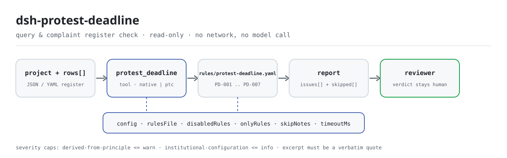

<div align="center">

<picture>
  <source media="(prefers-color-scheme: dark)" srcset="docs/assets/dsh-protest-deadline-flow-dark.svg">
  
</picture>

# dsh-protest-deadline

**Turn the gaps and out-of-order dates in a query-and-complaint register into a row-by-row list of what is missing — the verdict stays with the reviewer.**

A data-only checker plugin for DeepSeek Harness: it reads one query-and-complaint register (the project header plus one row per query), applies the versioned rule pack it ships (PD-001..PD-007), and lists only the differences it can point to inside the register — never a compliance verdict, never a liability finding.

[Install](#three-step-setup) · [Configuration](#configuration) · [FAQ](#faq) · [简体中文](README.md) · [English](README.en.md) · [Español](README.es.md) · [Português](README.pt.md) · [हिन्दी](README.hi.md)

[](LICENSE)
[](#compatibility)
[](https://www.npmjs.com/package/dsh-protest-deadline)
[](https://github.com/PerryLink/dsh-protest-deadline/actions/workflows/ci.yml)
[](#compatibility)

[](https://github.com/PerryLink/dsh-protest-deadline/stargazers)
[](https://www.npmjs.com/package/dsh-protest-deadline)
[](https://dshfind.com/plugins/PerryLink/dsh-protest-deadline?ref=badge)
[](https://securityscorecards.dev/viewer/?uri=github.com/PerryLink/dsh-protest-deadline)
[](https://dsh.market/)
[](https://gitee.com/perrylink/dsh-protest-deadline)

```sh
dsh plugin --profile <name> add dsh-protest-deadline
```

</div>

<sub>Community plugin, not affiliated with DeepSeek. Canonical repository: <https://github.com/PerryLink/dsh-protest-deadline> (Gitee is a mirror).</sub>

## What it is

`dsh-protest-deadline` reads one query-and-complaint register — the project header plus one row per query — and checks what such a register can be held to mechanically: that a raise date or a reply date is recorded on every row, that the two dates parse and follow one another, that the reply falls inside the deadline the register itself states, that the complaint date is not earlier than the reply date, that every status comes from your own vocabulary, that the header names the procurement project, and that the query numbers are unique.

It does not decide whether a query was filed inside the legal period, whether it should be accepted, or whether it should be rejected — the difference list goes to the reviewer.

- **Who it is for**: procurement agencies, government-procurement officers and internal-control reviewers; no command line required — hand the material over in chat.
- **What you give it**: the source material the check works on (a table, register, or document); the original is never modified. Excel can be converted to JSON/YAML first, in chat if the platform supports it.
- **What you get back**: a list of "which row, which column, what is missing, how to fix it"; every check that could not run is listed in `skipped` with its reason.

## Three-step setup

1. **Install** (pick one channel):

   ```sh
   # git channel (latest main; equivalent to git+https://github.com/PerryLink/dsh-protest-deadline.git)
   dsh plugin --profile <name> add github:PerryLink/dsh-protest-deadline
   # npm channel (published releases)
   dsh plugin --profile <name> add dsh-protest-deadline
   # tarball channel: pnpm pack in this repo, then
   dsh plugin --profile <name> add ./dsh-protest-deadline-<version>.tgz
   ```

2. **Minimal config** (sane defaults; a bundle row without `config` uses every default, with the rule-pack path pointing at the bundled `rules/protest-deadline.yaml`):

   ```yaml
   - insert:
       - id: dsh-protest-deadline
         name: dsh-protest-deadline
   ```

3. **Verify it mounts**:

   ```sh
   dsh --profile <name> --dump-config | grep 'dsh-protest-deadline'
   ```

   Then hand it a register — for example the bundled sample (expected output in `samples/quickstart/expected/result.json`):

   ```text
   > Run this check on the bundled sample and tell me how many issues it found and their severities.
   protest_deadline: 1 issue(s) — error 0, warn 1, info 0
   skipped: 1
   ```

   You can also run the sample locally first (build `lib/` with `pnpm run build`):

   ```sh
   node samples/quickstart/run.mjs --json
   ```

**Uninstall**: `dsh plugin --profile <name> remove dsh-protest-deadline` (or remove the row from the profile patch).

<details>
<summary>Use it in WorkBuddy / Coze</summary>

Search "Tender Compliance Suite" in WorkBuddy / Coze (the full set; this check is one part of it; availability as listed) to invoke the same checking capability without a command line.

</details>

## Core capabilities

`dsh-protest-deadline` registers the `protest_deadline` tool: it reads a register, applies a versioned rule pack, and returns a report.

- **Seven rules in one data pack** — the rule pack is data, not code (`rules/protest-deadline.yaml`); replacing it switches the whole rule set without touching a line of TypeScript.
- **Read-only on the material** — accepts JSON or YAML and never modifies the original; pure ESM, no network requests and no model calls.
- **No fabricated citations** — every rule carries `document` / `number` / `clause` / `excerpt` / `kind` / `source`; `excerpt` must be a verbatim quotation, and rules not yet traceable go to `rules/citations-baseline.json`, a list that may only shrink.
- **Severity follows the evidence** — `derived-from-principle` is capped at `warn`, institutional configuration (`institutional-configuration`) at `info`, and a test asserts it.
- **An empty issue list is never "nothing is wrong"** — every check that could not run is reported in `skipped` with its reason; a rule whose required list is unset reports itself in `skipped` rather than passing silently.
- **No adjudicating wording** — the report lists differences and never pronounces on compliance, liability, or correctness; a wording guard enforces this and every report carries the disclaimer.

| Rule | Check | Severity | Basis kind |
|---|---|---|---|
| `PD-001` | a raise date or a reply date is recorded on every row | warn | direct |
| `PD-002` | the reply date is not earlier than the raise date | warn | direct |
| `PD-003` | the reply falls inside the recorded deadline | info | local |
| `PD-004` | the complaint date is not earlier than the reply date | warn | direct |
| `PD-005` | the status comes from your vocabulary (off by default) | info | local |
| `PD-006` | the header names its procurement project (raise date optional) | warn | principle |
| `PD-007` | query numbers are unique in the register | warn | principle |

### Examples

These are the plugin's real entry points; install once, then call one. The first row below is the detailed walkthrough and the rest are short cases.

**Detailed example** — tool `protest_deadline`, input:

```json
{"project":"某某设备采购项目","projectNo":"ZC-2026-018","rows":[{"序号":"ZY-2026-001","质疑人":"某某科技有限公司","质疑提出日期":"","答复收到日期":"2026-03-07","答复期限":"2026-03-09","实际答复日期":""}]}
```

Output:

```json
{
  "id": "dsh-protest-deadline.PD-001.de09b5a6",
  "ruleId": "PD-001",
  "severity": "warn",
  "locator": {
    "row": 1,
    "field": "raisedAt"
  },
  "found": "第 1 行 raisedAt、replyAt 都为空",
  "expected": "raisedAt、replyAt 至少应填写一项",
  "fix": "补填质疑提出日期与答复日期；本条只核对是否填写，不判断是否在法定期限内"
}
```

*Observed from `dsh-protest-deadline/tests/fixtures/PD-001/PD-001-unsafe.json (cases.json expects 1×PD-001); executed parseMaterial+runCheck, checkedAt=2026-10-06T00:00:00.000Z`*

| You ask | What it answers |
|---|---|
| A row leaves both the raise date and the reply date blank. Is that reported? | Yes. `PD-001` requires at least one of `raisedAt` and `replyAt` on every row and reports the row where both are empty. It checks only that one of the two is filled, not whether the query was raised inside the legal period: that needs the date the supplier knew of the harm, the service date and a working-day count a register usually does not carry. |
| The reply date is written earlier than the raise date. Is that caught? | `PD-002` compares the raise date with the reply date row by row and reports `raisedAt` when it is later than `replyAt`; the same day counts as not later. A value it cannot parse — a date spelled out in words rather than as `2026-03-15`, `2026/3/15` or `2026-03-15 09:30` — is reported on that row instead of being passed over quietly. The rule only orders the two dates the register carries. |
| Our reply went out after the reply deadline recorded in the register. Was it late? | `PD-003` hard-codes no day count and cannot say "late": it compares the actual reply date with the deadline written in the register's own `replyDueAt` column, so a finding means "this disagrees with the deadline you recorded". With that column empty there is nothing to compare against and the rule reports itself in `skipped`, rather than assuming a period. |
| The status column says answered, yet nothing came back for it. Why? | `PD-005` compares the status with the vocabulary you configure, and `values` ships empty, so as delivered the rule reports itself in `skipped` — the choice of values belongs to your institution, not to the engine — instead of passing silently. Fill `values` with your own list (pending, answered, complained, withdrawn, …) and any value not on it is reported row by row. It checks that the value is on the list, never how the query should be handled. |
| The header names the project but carries no header-level raise date. Is something missing? | No. `PD-006` checks the header for the procurement project (`project`) only, because the raise date is normally a per-row column. If your form does state it in the header, the rule's own note says to set `fields` to `[project, raisedAt]`. A missing project is reported against the header, not against a row. |
| The same query number appears on two rows. | `PD-007` reports the second row and names the first, comparing the numbers with whitespace ignored. A repeat usually means the same query was registered twice or a number was copied — telling those apart is a human call. If the register carries no number column, the rule reports that it does not apply rather than passing. |

## Standards it follows

| Document | Number | Cited by rules |
|---|---|---|
| Measures for the Handling of Queries and Complaints in Government Procurement (the canonical Chinese title is recorded in `rules/evidence/`) | Ministry of Finance Order No. 94 (promulgated 26 December 2017, effective 1 March 2018; six chapters, forty-five articles; article 45 repeals Ministry of Finance Order No. 20, which this pack therefore never cites) | PD-001, PD-002, PD-003, PD-004, PD-005, PD-006, PD-007 |

**Boundary:** this plugin checks a **query-and-complaint register** for what a register can be held to mechanically — that the key dates are recorded, that they parse and follow one another, that a reply falls inside the deadline the register itself states, that statuses come from your vocabulary, and that query numbers are unique. It does **not** decide whether a query was filed in time, whether it should be accepted, or whether it should be rejected. **Those calls need the purchaser or the finance department, the service dates, and a working-day basis that a ledger usually does not record.**

> ### ⚠️ Read this before trusting a citation in the report
>
> **The text of Order No. 94 was obtained and read verbatim** — all six chapters and forty-five articles — and `rules/evidence/clause-verification.md` records what was quoted: article 10 (a query within **7 working days**), article 13 (a reply within **7 working days**), article 17 (a complaint within 15 working days **after the reply period expires**), article 21 (5 and 8 working days), article 26 (30 working days) and **article 42**, which fixes two calculation rules — the opening day is not counted, and the deadline rolls over when the final day is a holiday. Article 45 also **repealed** Order No. 20, so this pack never cites it. The full text of the superior Government Procurement Law was also read verbatim (`rules/evidence/clause-verification-law.md`), and its periods match the Order exactly.
>
> **Every rule's `excerpt` is now a verbatim quotation.** An earlier release stated "not obtained" inside `excerpt`; on 2026-10-07 the quotations were filled in and `check:citations` now holds that line. Every rule's severity is still `warn` or `info`. What this plugin checks is an internal register's dates and columns; the Order governs how purchasers and finance departments behave. Calling a blank column a `direct` breach of "shall reply within 7 working days" would dress a record-keeping gap up as a regulatory one.
>
> **This plugin hard-codes no day count, and the text itself shows why.** The periods run in **working days**, article 42 excludes the opening day from the count and rolls the deadline forward off a holiday, and article 17 starts the complaint clock from the **expiry of the reply period** rather than the reply date — while a register usually records calendar dates only. So `PD-003` compares the actual reply date against the deadline **written in the register's own `replyDueAt` column**, and with that column empty it reports itself in `skipped`. Its finding says "this disagrees with the deadline you recorded", **not** "the reply is late".

## Configuration

All tunables are Schemastery `Config` fields in `src/config.ts` (changeable from cordis.yml); the per-rule thresholds live in the rule pack under `rules/`. An id-targeted override replaces the whole row — restate every key you need.

| Key | Type | Default | Description |
|---|---|---|---|
| `rulesFile` | string | `rules/protest-deadline.yaml` | Rule-pack path, relative to the package root |
| `disabledRules` | string[] | `[]` | Rule ids to stop running; each appears in `skipped` |
| `onlyRules` | string[] | `[]` | Run only these rule ids; empty runs every rule |
| `skipNotes` | string | `""` | Note appended to every `skipped` reason |
| `timeoutMs` | number | `120000` | Cooperative tool timeout budget |

Rule-level parameters worth knowing:

- `PD-003` reads the register's `replyDueAt` column. Compute that deadline under Order No. 94 (working days, opening day and roll-over) and write it into the ledger; the plugin will not derive it.
- `PD-005` `values` — your status vocabulary, e.g. `[pending, answered, complained, closed, withdrawn]`.
- `PD-002` and `PD-004` compare date pairs; to also check the reply-to-complaint direction, add a second rule with `field: replyAt` and `notAfterField: complaintAt`.

Example override in your profile patch:

```yaml
- insert:
    - id: dsh-protest-deadline
      name: dsh-protest-deadline
      config:
        disabledRules: [PD-005]
        timeoutMs: 180000
```

## Material format

The tool accepts JSON or YAML:

```yaml
project: 某某设备采购项目
projectNo: ZC-2026-018
agency: 某某采购代理机构
rows:
  - { 序号: ZY-2026-001, 质疑人: 某某科技有限公司, 质疑提出日期: 2026-03-02,
      答复期限: 2026-03-09, 实际答复日期: 2026-03-06, 投诉日期: 2026-03-12, 处理状态: 已答复 }
```

Column names are matched case-insensitively and ignoring spaces, underscores and hyphens; the register's own column names are kept, so a finding names the column it read. Dates may be written `2026-03-02` or `2026-03-02 09:30`. Fields are optional at the reader layer and validated by the check engine, so a partial export produces "missing item" findings instead of crashing.

## Rule sources

Rule data lives in `rules/protest-deadline.yaml`, separated from the code: every rule carries a document, number, clause number in the source's own numbering, a verbatim excerpt, and a source URL. The load-time guard enforces that an excerpt is a real quotation of at least eight characters; a check whose basis is only a principle (`kind: derived-from-principle`, capped at `warn`) or an institutional setting (`kind: institutional-configuration`, capped at `info`) must never be marked `error`. A pack that overstates its basis fails on load instead of producing a confident-looking report.

The boundaries confirmed during verification and the conclusions deliberately **not** asserted ship in `rules/evidence/` (one report for the Order, one for the superior law).

## FAQ

<details>
<summary>Does it decide compliance for us?</summary>

No. It only lists the differences it can point to inside the material (which row, which column, what is missing, how to fix it) and does not decide facts or compliance — the conclusion always stays with the reviewer. A wording guard enforces the report wording, and every report carries the disclaimer.

</details>

<details>
<summary>My register is an Excel file. Can I use it directly?</summary>

Yes — convert it to JSON or YAML first; the platform can do the conversion in chat if it supports it. The tool only reads the material and never modifies the original.

</details>

<details>
<summary>Why does `PD-005` never report anything?</summary>

Because the pack ships no status vocabulary: `values` is empty by default, so the rule reports itself in `skipped`. Fill `values` with your institution's status spellings and the rule starts checking that the recorded status is on the list; it still does not judge how the query should be handled.

</details>

<details>
<summary>Can an empty `issues` list be read as "nothing is wrong"?</summary>

No. Every check that could not run appears in `skipped` with its reason (an empty status vocabulary, a missing column, a blank reply deadline). Read `issues` and `skipped` together before drawing any conclusion from a report.

</details>

<details>
<summary>Why does `PD-003` say "disagrees" instead of "late"?</summary>

Because it only compares the actual reply date with the deadline the register itself states in `replyDueAt`. The statutory reply period runs in working days with its own opening-day and roll-over rules, while a register usually records calendar dates; the plugin will not convert calendar days into working days or assume a deadline for you. A finding means "this disagrees with the deadline you recorded".

</details>

<details>
<summary>Is the material uploaded or used for training?</summary>

No. The plugin does not use the network, does not call a model, only reads the material, and never writes back to the original; the report is produced locally.

</details>

## Security boundaries

- **Read-only on the material.** The tool reads the file or inline text you hand it and never modifies the original; there is no write-back path and no second copy.
- **No network, no model call.** The check itself is local column matching and date comparison; `package.json`'s `dsh.demo` also marks `network` as `false` and `writes` as empty.
- **No adjudicating wording.** The report never pronounces on compliance, liability or correctness; the wording guard enforces this and every report carries the disclaimer.
- **No fabricated citations.** An `excerpt` must be a verbatim quotation findable in `rules/evidence/`; untraceable rules go to `citations-baseline.json`, a list that may only shrink.
- **Fails closed.** Out-of-range severities, missing required lists and unloadable rule packs raise an explicit error at load or run time instead of producing a plausible-looking empty report.

## Known limitations

- **No day count is hard-coded.** The statutory reply period runs in working days and is subject to article 42's opening-day and roll-over rules, so `PD-003` only compares against the register's own `replyDueAt`; with that column empty it goes to `skipped`.
- **Dates must be numeric.** `2026-03-02` and `2026-03-02 09:30` parse; a date spelled out in words is reported as unparseable — deliberate, to avoid guessing.
- **`PD-005` is inactive out of the box.** Status values differ between institutions, so the plugin ships no status list.
- **Register fields only.** It does not check service dates, attachments, the review process, or the substance of a query or complaint.
- **JSON or YAML only.** Excel and other formats must be converted first; the tool does not parse binary spreadsheets.
- **Evidence gaps are stated, not papered over.** The Government Procurement Law copy read was the 2002 promulgated text; the 2014 amendment was not obtained, so no claim is made about "current validity".
- **`timeoutMs` is a cooperative budget.** It bounds the tool's wait, not a hard interrupt; very large registers should still be submitted in batches.

## Interoperability with other DSH plugins

The plugin occupies one tool name and takes part in no command, event or UI seat contention:

- **One tool only.** The tool is named `protest_deadline`; it registers no command, no client slot and no `webServer` prefix. If it collides with a tool of your own, remove this row to uninstall it.
- **Declares the `tools` service only.** `inject` contains `tools` and nothing else, so there is no service-key conflict.
- **Listens to no events.** There are no `agent/pre-step` or `tools/post-execute` listeners, so it neither inserts into nor short-circuits a shared event chain.
- **The patch only inserts its own row.** The bundle layer never overwrites a built-in row's `config` and never mutates globals or `process.env`.

## Compatibility

| Surface | Status |
|---|---|
| Harness | Peer range `>=0.1.2-rc.1 <0.2.0 \|\| >=0.2.0-0 <0.3.0` — verified to accept both `0.2.0-rc.2` and `0.2.1-rc.2`. `engines.dsh` is declared as `>=0.2.1-0 <0.3.0` and is enforced by the host since 0.2.1 |
| Node | `^22.19.0 \|\| >=24.0.0` |
| Platforms | All (plain ESM; no native code, no network, no model call) |
| Tool mode | Works in `native` and `ptc`; for a whole directory use `ptc`, where the schema cost is paid once |

## Troubleshooting

- **`PD-003` reports itself as skipped.** The register records no reply deadline. That is deliberate: the statutory period is counted in working days and the plugin will not convert calendar dates into it.
- **`PD-003` fires but I consider the reply timely.** The register's `replyDueAt` disagrees with the actual reply date. Either the deadline column was computed wrongly or the reply date is wrong.
- **`PD-005` never runs.** Its status vocabulary is empty; fill it with your register's status values.
- **`PD-002` fires on dates I can read.** The reader accepts `2026-03-02` and `2026-03-02 09:30`; a date written out in words is reported as unparseable on purpose.
- **The plugin installs but the tool never appears.** Check that `main` resolves to `lib/index.mjs` and that `pnpm run build` produced it; a wrong `main` makes the loader skip the entry silently.
- **`dsh plugin add` refuses the package as incompatible.** The peer range covers `0.1.x` and `0.2.x`; if your runtime sits outside it, grant an explicit exemption: `dsh plugin --profile <name> allow-version dsh-protest-deadline@0.1.0 --dsh-version <runtime> --accept-risk`
- **`check` reports `manifest-peers` as failed.** The static checker compares against a hard-coded peer range that predates the 0.2 line. The runtime enforces peer compatibility at install time, so the declared range is the correct one; this is a known upstream issue in `dsh-plugin-dev`.
- **Times look shifted.** All arithmetic is wall-clock on the input strings, with no timezone conversion.

## Ecosystem & quality

- [Gitee mirror](https://gitee.com/perrylink/dsh-protest-deadline) (sync mirror; GitHub is canonical)
- [dshfind plugin page](https://dshfind.com/plugins/PerryLink/dsh-protest-deadline) (installs and ranking)
- [OpenSSF Scorecard report](https://securityscorecards.dev/viewer/?uri=github.com/PerryLink/dsh-protest-deadline) (driven by [.github/workflows/scorecard.yml](.github/workflows/scorecard.yml))
- [DSH Market](https://dsh.market/) (listed)
- **1024 store channel**: `npm i -g dsh1024` once, then `dsh1024 plugin --profile <name> add dsh-protest-deadline` (counts toward the [deepseek1024.com](https://deepseek1024.com) install ranking)
- [Ecosystem knowledge base](https://perrylink.github.io/dsh-plugin-guide/) — plugin development guide · plugin-selection data · maintenance criteria

## Development

```sh
pnpm install                                        # node ^22.19 || >=24
pnpm run typecheck                                  # tsc --noEmit
pnpm test                                           # vitest: shared table-plugin suite + paired fixtures
pnpm run build                                      # tsdown -> lib/index.mjs + lib/index.d.mts
pnpm run verify:self-contained                      # dependency specs resolve from the registry
pnpm run check:lockfile                             # lockfile drift check
pnpm run check:readmes                              # five-language README consistency
pnpm run check:citations                            # rule-pack citation baseline
node ../scripts/sync-shared.mjs dsh-protest-deadline  # refresh src/shared from ../_shared
pnpm pack                                           # the published tarball
```

The plugin is **data-only**: `src/model.ts` declares the table shape, the shared kit supplies the reader and the check engine, and the rule pack declares every check. Local sample run (build `lib/` first):

```sh
node samples/quickstart/run.mjs --json
# => {"tool":"protest_deadline","issueCount":1,"summary":{"error":0,"warn":1,"info":0},"skippedCount":1}
```

The sample input lives in `samples/quickstart/input/`, the expected output in `samples/quickstart/expected/result.json`, and a screenshot in `docs/assets/quickstart.png`. The README images are generated programmatically by [`scripts/gen-readme-assets.py`](scripts/gen-readme-assets.py) (Python + Pillow) and the script can be re-run; the old single-skin flow diagram and demo images stay in `docs/assets/` for external links, while the READMEs reference only the new light/dark pair.

Topics: `deepseek-harness`, `dsh`, `dsh-plugin`, `cordis`, `protest`, `deadline`

## Family & thanks

This project is part of the DeepSeek Harness plugin family from [PerryLink](https://github.com/PerryLink) (all Apache-2.0). Full family index: [choose a checker by material](https://perrylink.github.io/zh/checkers/choose/). If it is useful, **a star helps the next person find it** — nothing is gated behind it.

- [@PerryLink](https://github.com/PerryLink) — creator and maintainer: the data-only rule pack (PD-001..PD-007), the `protest_deadline` tool, the citation-verification record, and the five-language docs.

<details>
<summary>Expand all plugins</summary>

| Plugin | Status |
|---|---|
| **[dsh-aqua-input-check](https://github.com/PerryLink/dsh-aqua-input-check)** |  |
| **[dsh-archive-check](https://github.com/PerryLink/dsh-archive-check)** |  |
| **[dsh-auto-review](https://github.com/PerryLink/dsh-auto-review)** |  |
| **[dsh-autotier](https://github.com/PerryLink/dsh-autotier)** | 🧊 FROZEN — see the repo README |
| **[dsh-bid-ca-precheck](https://github.com/PerryLink/dsh-bid-ca-precheck)** |  |
| **[dsh-bid-qual-check](https://github.com/PerryLink/dsh-bid-qual-check)** |  |
| **[dsh-cert-mcp](https://github.com/PerryLink/dsh-cert-mcp)** | 🧊 FROZEN — see the repo README |
| **[dsh-checkpoint-rewind](https://github.com/PerryLink/dsh-checkpoint-rewind)** |  |
| **[dsh-click](https://github.com/PerryLink/dsh-click)** |  |
| **[dsh-composer-history](https://github.com/PerryLink/dsh-composer-history)** |  |
| **[dsh-contract-stance](https://github.com/PerryLink/dsh-contract-stance)** |  |
| **[dsh-customs-doc-check](https://github.com/PerryLink/dsh-customs-doc-check)** |  |
| **[dsh-data-quality](https://github.com/PerryLink/dsh-data-quality)** | 🧊 FROZEN — see the repo README |
| **[dsh-demurrage-ledger](https://github.com/PerryLink/dsh-demurrage-ledger)** |  |
| **[dsh-doublecheck](https://github.com/PerryLink/dsh-doublecheck)** |  |
| **[dsh-drill-script-check](https://github.com/PerryLink/dsh-drill-script-check)** |  |
| **[dsh-eia-guide-check](https://github.com/PerryLink/dsh-eia-guide-check)** |  |
| **[dsh-emergency-plan](https://github.com/PerryLink/dsh-emergency-plan)** |  |
| **[dsh-essay-rubric-check](https://github.com/PerryLink/dsh-essay-rubric-check)** |  |
| **[dsh-evidence-check](https://github.com/PerryLink/dsh-evidence-check)** |  |
| **[dsh-export-ctl-check](https://github.com/PerryLink/dsh-export-ctl-check)** |  |
| **[dsh-fast](https://github.com/PerryLink/dsh-fast)** |  |
| **[dsh-fmea-table-check](https://github.com/PerryLink/dsh-fmea-table-check)** |  |
| **[dsh-forecast-penalty](https://github.com/PerryLink/dsh-forecast-penalty)** |  |
| **[dsh-fund-research](https://github.com/PerryLink/dsh-fund-research)** |  |
| **[dsh-github](https://github.com/PerryLink/dsh-github)** |  |
| **[dsh-gongwen-flow-check](https://github.com/PerryLink/dsh-gongwen-flow-check)** |  |
| **[dsh-gongwen-word-check](https://github.com/PerryLink/dsh-gongwen-word-check)** |  |
| **[dsh-guard-plan-qc](https://github.com/PerryLink/dsh-guard-plan-qc)** |  |
| **[dsh-hazchem-check](https://github.com/PerryLink/dsh-hazchem-check)** |  |
| **[dsh-hazplan-check](https://github.com/PerryLink/dsh-hazplan-check)** |  |
| **[dsh-hidden-risk-map](https://github.com/PerryLink/dsh-hidden-risk-map)** |  |
| **[dsh-hs-classify](https://github.com/PerryLink/dsh-hs-classify)** |  |
| **[dsh-icd-rule-check](https://github.com/PerryLink/dsh-icd-rule-check)** |  |
| **[dsh-industry-research](https://github.com/PerryLink/dsh-industry-research)** |  |
| **[dsh-lawcite-adapter](https://github.com/PerryLink/dsh-lawcite-adapter)** |  |
| **[dsh-laya](https://github.com/PerryLink/dsh-laya)** |  |
| **[dsh-lc-doc-check](https://github.com/PerryLink/dsh-lc-doc-check)** |  |
| **[dsh-learning-gap-check](https://github.com/PerryLink/dsh-learning-gap-check)** |  |
| **[dsh-library](https://github.com/PerryLink/dsh-library)** |  |
| **[dsh-local-ai](https://github.com/PerryLink/dsh-local-ai)** |  |
| **[dsh-lsp-actions](https://github.com/PerryLink/dsh-lsp-actions)** |  |
| **[dsh-mask](https://github.com/PerryLink/dsh-mask)** |  |
| **[dsh-mcp-panel](https://github.com/PerryLink/dsh-mcp-panel)** |  |
| **[dsh-medrec-qc](https://github.com/PerryLink/dsh-medrec-qc)** |  |
| **[dsh-memento](https://github.com/PerryLink/dsh-memento)** | 🧊 FROZEN — see the repo README |
| **[dsh-nsfc-form-check](https://github.com/PerryLink/dsh-nsfc-form-check)** |  |
| **[dsh-nurse-record-check](https://github.com/PerryLink/dsh-nurse-record-check)** |  |
| **[dsh-observe](https://github.com/PerryLink/dsh-observe)** |  |
| **[dsh-origin-rvc-check](https://github.com/PerryLink/dsh-origin-rvc-check)** |  |
| **[dsh-ota-review-check](https://github.com/PerryLink/dsh-ota-review-check)** |  |
| **[dsh-output-styles](https://github.com/PerryLink/dsh-output-styles)** |  |
| **[dsh-paper-doc-adapter](https://github.com/PerryLink/dsh-paper-doc-adapter)** |  |
| **[dsh-permission-rules](https://github.com/PerryLink/dsh-permission-rules)** |  |
| **[dsh-permit-report-check](https://github.com/PerryLink/dsh-permit-report-check)** |  |
| **[dsh-pipeline-check](https://github.com/PerryLink/dsh-pipeline-check)** |  |
| **[dsh-pleading-draft](https://github.com/PerryLink/dsh-pleading-draft)** |  |
| **[dsh-plugin-doctor](https://github.com/PerryLink/dsh-plugin-doctor)** | 🚫 RETIRED (repo archived) |
| **[dsh-plugin-guide](https://github.com/PerryLink/dsh-plugin-guide)** |  |
| **[dsh-plugin-kit](https://github.com/PerryLink/dsh-plugin-kit)** | 🚫 RETIRED (repo archived) |
| **[dsh-plugin-upgrade](https://github.com/PerryLink/dsh-plugin-upgrade)** | 🚫 RETIRED (repo archived) |
| **[dsh-policy-brief-draft](https://github.com/PerryLink/dsh-policy-brief-draft)** |  |
| **[dsh-power-loss-split](https://github.com/PerryLink/dsh-power-loss-split)** |  |
| **[dsh-power-ticket-check](https://github.com/PerryLink/dsh-power-ticket-check)** |  |
| **[dsh-ppap-check](https://github.com/PerryLink/dsh-ppap-check)** |  |
| **[dsh-protest-deadline](https://github.com/PerryLink/dsh-protest-deadline)** |  |
| **[dsh-railway-window](https://github.com/PerryLink/dsh-railway-window)** |  |
| **[dsh-repair-order-qc](https://github.com/PerryLink/dsh-repair-order-qc)** |  |
| **[dsh-research-report](https://github.com/PerryLink/dsh-research-report)** |  |
| **[dsh-review-reply-check](https://github.com/PerryLink/dsh-review-reply-check)** |  |
| **[dsh-rulefile-check](https://github.com/PerryLink/dsh-rulefile-check)** |  |
| **[dsh-safety-brief-check](https://github.com/PerryLink/dsh-safety-brief-check)** |  |
| **[dsh-score](https://github.com/PerryLink/dsh-score)** | 🧊 FROZEN — see the repo README |
| **[dsh-session-sync](https://github.com/PerryLink/dsh-session-sync)** |  |
| **[dsh-site-log-check](https://github.com/PerryLink/dsh-site-log-check)** |  |
| **[dsh-skill-pack-security](https://github.com/PerryLink/dsh-skill-pack-security)** |  |
| **[dsh-soe-decision-check](https://github.com/PerryLink/dsh-soe-decision-check)** |  |
| **[dsh-soilwater-check](https://github.com/PerryLink/dsh-soilwater-check)** |  |
| **[dsh-sop-sync-check](https://github.com/PerryLink/dsh-sop-sync-check)** |  |
| **[dsh-spc-gbt-adapter](https://github.com/PerryLink/dsh-spc-gbt-adapter)** |  |
| **[dsh-talk](https://github.com/PerryLink/dsh-talk)** |  |
| **[dsh-tender-extract](https://github.com/PerryLink/dsh-tender-extract)** |  |
| **[dsh-tender-matrix](https://github.com/PerryLink/dsh-tender-matrix)** |  |
| **[dsh-test-drive](https://github.com/PerryLink/dsh-test-drive)** |  |
| **[dsh-ticktick](https://github.com/PerryLink/dsh-ticktick)** | 🚫 RETIRED (repo archived) |
| **[dsh-translate](https://github.com/PerryLink/dsh-translate)** |  |
| **[dsh-warranty-calc](https://github.com/PerryLink/dsh-warranty-calc)** |  |
| **[dsh-budget](https://github.com/PerryLink/dsh-budget)** | 🧊 FROZEN — see the repo README |
| **[dsh-claude-move](https://github.com/PerryLink/dsh-claude-move)** | 🧊 FROZEN — see the repo README |
| **[dsh-defend](https://github.com/PerryLink/dsh-defend)** | 🧊 FROZEN — see the repo README |
| **[dsh-draw](https://github.com/PerryLink/dsh-draw)** | 🧊 FROZEN — see the repo README |
| **[dsh-reach](https://github.com/PerryLink/dsh-reach)** | 🧊 FROZEN — see the repo README |
| **[dsh-background-agents](https://github.com/PerryLink/dsh-background-agents)** | 🚫 RETIRED (repo archived) |
| **[dsh-session-pin](https://github.com/PerryLink/dsh-session-pin)** | 🚫 RETIRED (repo archived) |
| **[dsh-team-rooms](https://github.com/PerryLink/dsh-team-rooms)** | 🚫 RETIRED (repo archived) |

</details>

## License

[LICENSE](LICENSE) (Apache License 2.0) © 2026 dsh-protest-deadline contributors

<p align="center"><sub>Apache-2.0 · Community plugin, not affiliated with DeepSeek.</sub></p>
