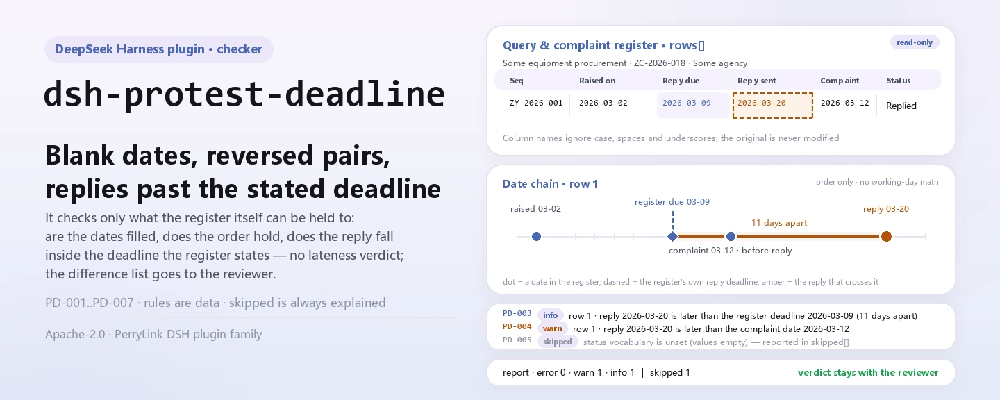
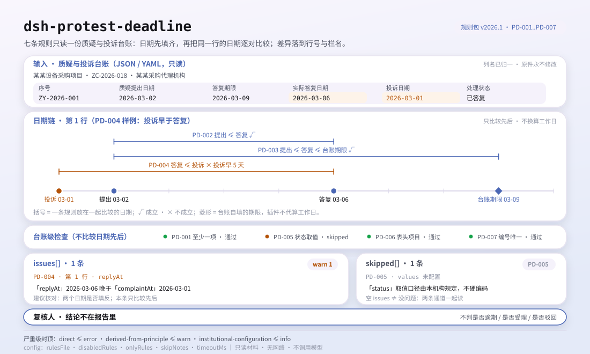

<div align="center">

<picture>
  <source media="(prefers-color-scheme: dark)" srcset="docs/assets/dsh-protest-deadline-hero-en-dark.webp">
  
</picture>

# dsh-protest-deadline

**Convierta los huecos y las fechas desordenadas de un registro de impugnaciones y denuncias en una lista fila por fila de lo que falta — el veredicto se queda con el revisor.**

Complemento de verificación de solo datos para DeepSeek Harness: lee un registro de impugnaciones y denuncias (la cabecera del proyecto más una fila por impugnación), aplica el paquete de reglas versionado que incluye (PD-001..PD-007) y solo enumera las diferencias que puede señalar dentro del registro: nunca un veredicto de cumplimiento, nunca una atribución de responsabilidad.

[Instalar](#instalación-en-tres-pasos) · [Configuración](#configuración) · [FAQ](#faq) · [简体中文](README.md) · [English](README.en.md) · [Español](README.es.md) · [Português](README.pt.md) · [हिन्दी](README.hi.md)

[](LICENSE)
[](#compatibilidad)
[](https://www.npmjs.com/package/dsh-protest-deadline)
[](https://github.com/PerryLink/dsh-protest-deadline/actions/workflows/ci.yml)
[](#compatibilidad)

[](https://github.com/PerryLink/dsh-protest-deadline/stargazers)
[](https://www.npmjs.com/package/dsh-protest-deadline)
[](https://dshfind.com/plugins/PerryLink/dsh-protest-deadline?ref=badge)
[](https://securityscorecards.dev/viewer/?uri=github.com/PerryLink/dsh-protest-deadline)
[](https://dsh.market/)
[](https://gitee.com/perrylink/dsh-protest-deadline)

```sh
dsh plugin --profile <name> add dsh-protest-deadline
```

</div>

<sub>Complemento de la comunidad, sin relación con DeepSeek. Repositorio canónico: <https://github.com/PerryLink/dsh-protest-deadline> (Gitee es un espejo).</sub>

## Qué es

`dsh-protest-deadline` lee un registro de impugnaciones y denuncias —la cabecera del proyecto más una fila por impugnación— y comprueba lo que ese registro puede sostener mecánicamente: que en cada fila esté registrada la fecha de presentación o la de respuesta, que ambas fechas se puedan analizar y sigan un orden, que la respuesta caiga dentro del plazo que el propio registro declara, que la fecha de la denuncia no sea anterior a la de la respuesta, que cada estado provenga de su propio vocabulario, que la cabecera nombre el proyecto de contratación y que los números de impugnación no se repitan.

No decide si la impugnación se presentó dentro del plazo legal, si debe admitirse o si debe rechazarse: la lista de diferencias va al revisor.

- **Para quién es**: agencias de contratación, responsables de compras públicas y revisores de control interno; no requiere línea de comandos — entregue el material en el chat.
- **Qué le entrega**: el material original sobre el que trabaja la comprobación (una tabla, un registro o un documento); el original nunca se modifica. Excel puede convertirse antes a JSON/YAML, en el chat si la plataforma lo permite.
- **Qué recibe**: una lista de «qué fila, qué columna, qué falta y cómo corregirlo»; toda comprobación que no pudo ejecutarse aparece en `skipped` con su motivo.

<picture>
  <source media="(prefers-color-scheme: dark)" srcset="docs/assets/dsh-protest-deadline-flow-v5-dark.svg">
  
</picture>

## Instalación en tres pasos

1. **Instalar** (elija un canal):

   ```sh
   # canal git (main más reciente; equivale a git+https://github.com/PerryLink/dsh-protest-deadline.git)
   dsh plugin --profile <name> add github:PerryLink/dsh-protest-deadline
   # canal npm (versiones publicadas)
   dsh plugin --profile <name> add dsh-protest-deadline
   # canal tarball: tras pnpm pack en este repositorio
   dsh plugin --profile <name> add ./dsh-protest-deadline-<version>.tgz
   ```

2. **Configuración mínima** (los valores por defecto ya sirven; una fila de bundle sin `config` usa todos los valores por defecto y la ruta del paquete de reglas apunta al `rules/protest-deadline.yaml` incluido):

   ```yaml
   - insert:
       - id: dsh-protest-deadline
         name: dsh-protest-deadline
   ```

3. **Verificar que se montó**:

   ```sh
   dsh --profile <name> --dump-config | grep 'dsh-protest-deadline'
   ```

   Después entréguele un registro; por ejemplo, la muestra incluida (salida esperada en `samples/quickstart/expected/result.json`):

   ```text
   > Ejecuta esta comprobación con la muestra incluida y dime cuántos problemas encontró y de qué nivel.
   protest_deadline: 1 issue(s) — error 0, warn 1, info 0
   skipped: 1
   ```

   También puede ejecutar la muestra en local (compile `lib/` con `pnpm run build`):

   ```sh
   node samples/quickstart/run.mjs --json
   ```

**Desinstalar**: `dsh plugin --profile <name> remove dsh-protest-deadline` (o quite la fila del patch del perfil).

<details>
<summary>Usarlo en WorkBuddy / Coze</summary>

Busque «Tender Compliance Suite» en WorkBuddy / Coze (el conjunto completo; esta comprobación es una parte; disponibilidad según el catálogo) para invocar la misma capacidad sin línea de comandos.

</details>

## Capacidades clave

`dsh-protest-deadline` registra la herramienta `protest_deadline`: lee un registro, aplica un paquete de reglas versionado y devuelve un informe.

- **Siete reglas en un paquete de datos** — el paquete de reglas es datos, no código (`rules/protest-deadline.yaml`); sustituirlo cambia todo el conjunto de comprobaciones sin tocar una línea de TypeScript.
- **Solo lectura sobre el material** — acepta JSON o YAML y nunca modifica el original; ESM puro, sin peticiones de red ni llamadas al modelo.
- **Sin citas inventadas** — cada regla lleva `document` / `number` / `clause` / `excerpt` / `kind` / `source`; `excerpt` debe ser una cita literal, y las reglas aún no trazables van a `rules/citations-baseline.json`, una lista que solo puede encogerse.
- **La severidad sigue a la evidencia** — `derived-from-principle` tiene tope `warn`, la configuración institucional (`institutional-configuration`) tope `info`, y una prueba lo verifica.
- **Una lista de problemas vacía nunca significa «no hay nada mal»** — toda comprobación que no pudo ejecutarse se informa en `skipped` con su motivo; una regla cuya lista obligatoria no está configurada se informa a sí misma en `skipped` en lugar de pasar en silencio.
- **Sin lenguaje que sentencie** — el informe enumera diferencias y nunca se pronuncia sobre cumplimiento, responsabilidad o corrección; un guardián de redacción lo impone y todo informe lleva el descargo de responsabilidad.

| Regla | Comprobación | Severidad | Tipo de base |
|---|---|---|---|
| `PD-001` | en cada fila consta la fecha de presentación o la de respuesta | warn | direct |
| `PD-002` | la fecha de respuesta no es anterior a la de presentación | warn | direct |
| `PD-003` | la respuesta cae dentro del plazo registrado | info | local |
| `PD-004` | la fecha de la denuncia no es anterior a la de respuesta | warn | direct |
| `PD-005` | el estado proviene de su vocabulario (desactivada por defecto) | info | local |
| `PD-006` | la cabecera nombra el proyecto de contratación (fecha de presentación opcional) | warn | principle |
| `PD-007` | los números de impugnación son únicos en el registro | warn | principle |

### Ejemplos

Estos son los puntos de entrada reales del complemento; instálelo una vez y llame a uno. La primera fila es el caso detallado y las demás son casos breves.

**Ejemplo detallado** — herramienta `protest_deadline`, entrada:

```json
{"project":"某某设备采购项目","projectNo":"ZC-2026-018","rows":[{"序号":"ZY-2026-001","质疑人":"某某科技有限公司","质疑提出日期":"","答复收到日期":"2026-03-07","答复期限":"2026-03-09","实际答复日期":""}]}
```

Salida:

```json
{
  "id": "dsh-protest-deadline.PD-001.de09b5a6",
  "ruleId": "PD-001",
  "severity": "warn",
  "locator": {
    "row": 1,
    "field": "raisedAt"
  },
  "found": "第 1 行 raisedAt、replyAt 都为空",
  "expected": "raisedAt、replyAt 至少应填写一项",
  "fix": "补填质疑提出日期与答复日期；本条只核对是否填写，不判断是否在法定期限内"
}
```

*Observado en `dsh-protest-deadline/tests/fixtures/PD-001/PD-001-unsafe.json (cases.json expects 1×PD-001); executed parseMaterial+runCheck, checkedAt=2026-10-06T00:00:00.000Z`*

| Usted pregunta | Qué responde |
|---|---|
| Una fila deja en blanco tanto la fecha de presentación como la de respuesta. ¿Se informa? | Sí. `PD-001` exige que en cada fila esté relleno al menos uno de `raisedAt` y `replyAt`, e informa de la fila en la que ambos están vacíos. Solo comprueba que uno de los dos esté puesto, no si la impugnación se presentó dentro del plazo legal: eso exige la fecha en que el proveedor conoció el daño, la fecha de notificación y un cómputo en días hábiles que el registro no suele llevar. |
| La fecha de respuesta figura antes que la de presentación. ¿Se detecta? | `PD-002` compara fila por fila la fecha de presentación con la de respuesta e informa de `raisedAt` cuando es posterior a `replyAt`; el mismo día no cuenta como posterior. Un valor que no puede analizar —una fecha escrita con palabras en lugar de `2026-03-15`, `2026/3/15` o `2026-03-15 09:30`— se informa en esa fila en lugar de dejarlo pasar en silencio. La regla solo ordena las dos fechas que el registro contiene. |
| Nuestra respuesta salió después del plazo registrado en el registro. ¿Fue tardía? | `PD-003` no incorpora ningún número de días y no puede decir «tardía»: compara la fecha real de la respuesta con el plazo escrito en la propia columna `replyDueAt` del registro, de modo que un hallazgo significa «esto no concuerda con el plazo que usted registró». Si esa columna está vacía no hay con qué comparar y la regla aparece en `skipped`, en lugar de suponer un plazo. |
| La columna de estado dice «respondida» y no se informó nada de ella. ¿Por qué? | `PD-005` contrasta el estado con el vocabulario que usted configure, y `values` viene vacío, así que tal como se entrega la regla aparece en `skipped` —la elección de los valores corresponde a su institución, no al motor— en lugar de pasar en silencio. Rellene `values` con su propia lista (pendiente, respondida, denunciada, retirada, …) y todo valor que no figure en ella se informará fila por fila. Solo comprueba que el valor esté en la lista, nunca cómo debe tramitarse la impugnación. |
| La cabecera nombra el proyecto pero no lleva la fecha de presentación a nivel de cabecera. ¿Falta algo? | No. `PD-006` solo comprueba en la cabecera el proyecto de contratación (`project`), porque la fecha de presentación suele ser una columna por fila. Si su formulario sí la declara en la cabecera, la propia nota de la regla indica poner `fields` en `[project, raisedAt]`. La falta del proyecto se informa contra la cabecera, no contra una fila. |
| El mismo número de impugnación aparece en dos filas. | `PD-007` informa de la segunda fila y nombra la primera, comparando los números sin tener en cuenta los espacios. Una repetición suele significar que la misma impugnación se registró dos veces o que se copió mal un número: distinguirlo es una decisión humana. Si el registro no lleva columna de número, la regla informa de que no se aplica en lugar de pasar. |

## Normas que sigue

| Documento | Número | Reglas que lo citan |
|---|---|---|
| Medidas para la tramitación de impugnaciones y denuncias en la contratación pública (el título chino canónico consta en `rules/evidence/`) | Orden del Ministerio de Hacienda n.º 94 (promulgada el 26 de diciembre de 2017, en vigor desde el 1 de marzo de 2018; seis capítulos y cuarenta y cinco artículos; el artículo 45 deroga la Orden n.º 20, que por ello este paquete nunca cita) | PD-001, PD-002, PD-003, PD-004, PD-005, PD-006, PD-007 |

**Límite:** este complemento comprueba un **registro de impugnaciones y denuncias** en lo que un registro puede sostener mecánicamente: que las fechas clave estén registradas, que se puedan analizar y sigan un orden, que una respuesta caiga dentro del plazo que el propio registro declara, que los estados provengan de su vocabulario y que los números de impugnación sean únicos. **No** decide si una impugnación se presentó en plazo, si debe admitirse o si debe rechazarse. **Esas decisiones requieren al comprador o al departamento de finanzas, las fechas de notificación y una base de días hábiles que el libro no suele registrar.**

> ### ⚠️ Lea esto antes de confiar en una cita del informe
>
> **El texto de la Orden n.º 94 se obtuvo y se leyó literalmente** —los seis capítulos y cuarenta y cinco artículos— y `rules/evidence/clause-verification.md` registra lo citado: artículo 10 (impugnación en **7 días hábiles**), artículo 13 (respuesta en **7 días hábiles**), artículo 17 (denuncia en 15 días hábiles **tras vencer el plazo de respuesta**), artículo 21 (5 y 8 días hábiles), artículo 26 (30 días hábiles) y **artículo 42**, que fija dos reglas de cálculo —el día inicial no se cuenta y el plazo se prorroga cuando el último día es festivo—. El artículo 45 además **derogó** la Orden n.º 20, por lo que este paquete nunca la cita. El texto completo de la Ley de Contratación Pública, norma superior, también se leyó literalmente (`rules/evidence/clause-verification-law.md`), y sus plazos coinciden exactamente con los de la Orden.
>
> **El `excerpt` de cada regla es ahora una cita literal.** Una versión anterior indicaba «no obtenido» dentro de `excerpt`; el 2026-10-07 se rellenaron las citas y `check:citations` mantiene esa disciplina. La severidad de cada regla sigue siendo `warn` o `info`. Lo que este complemento comprueba son las fechas y columnas de un registro interno; la Orden regula cómo deben actuar los compradores y los departamentos de finanzas. Llamar «infracción `direct`» de «responder en 7 días hábiles» a una columna vacía sería disfrazar una laguna de registro de incumplimiento normativo.
>
> **Este complemento no fija ningún número de días, y el propio texto explica por qué.** Los plazos corren en **días hábiles**, el artículo 42 excluye el día inicial del cómputo y prorroga el plazo cuando el último día es festivo, y el artículo 17 cuenta la denuncia desde el **vencimiento del plazo de respuesta**, no desde la fecha de respuesta —mientras que un registro suele anotar solo fechas naturales—. Por eso `PD-003` compara la fecha real de respuesta con el plazo **escrito en la propia columna `replyDueAt` del registro**, y con esa columna vacía se informa a sí misma en `skipped`. Su hallazgo dice «esto no concuerda con el plazo que usted registró», **no** «la respuesta es tardía».

## Configuración

Todos los parámetros ajustables son campos Schemastery `Config` en `src/config.ts` (modificables desde cordis.yml); los umbrales por regla están en el paquete de reglas bajo `rules/`. Una anulación dirigida por id sustituye toda la fila: repita todas las claves que necesite.

| Clave | Tipo | Predeterminado | Descripción |
|---|---|---|---|
| `rulesFile` | string | `rules/protest-deadline.yaml` | Ruta del paquete de reglas, relativa a la raíz del paquete |
| `disabledRules` | string[] | `[]` | Ids de reglas que se dejan de ejecutar; cada una aparece en `skipped` |
| `onlyRules` | string[] | `[]` | Ejecutar solo estas reglas; vacío ejecuta todas |
| `skipNotes` | string | `""` | Nota añadida a cada motivo de `skipped` |
| `timeoutMs` | number | `120000` | Presupuesto de tiempo de espera cooperativo de la herramienta |

Parámetros por regla que conviene conocer:

- `PD-003` lee la columna `replyDueAt` del registro. Calcule ese plazo según la Orden n.º 94 (días hábiles, día inicial y prórroga) y escríbalo en el libro; el complemento no lo deduce.
- `PD-005` `values` — su vocabulario de estados, p. ej. `[pendiente, respondida, denunciada, cerrada, retirada]`.
- `PD-002` y `PD-004` comparan pares de fechas; para comprobar también la dirección respuesta→denuncia, añada una segunda regla con `field: replyAt` y `notAfterField: complaintAt`.

Ejemplo de anulación en el patch del perfil:

```yaml
- insert:
    - id: dsh-protest-deadline
      name: dsh-protest-deadline
      config:
        disabledRules: [PD-005]
        timeoutMs: 180000
```

## Formato del material

La herramienta acepta JSON o YAML:

```yaml
project: 某某设备采购项目
projectNo: ZC-2026-018
agency: 某某采购代理机构
rows:
  - { 序号: ZY-2026-001, 质疑人: 某某科技有限公司, 质疑提出日期: 2026-03-02,
      答复期限: 2026-03-09, 实际答复日期: 2026-03-06, 投诉日期: 2026-03-12, 处理状态: 已答复 }
```

Los nombres de columna se comparan sin distinguir mayúsculas y sin tener en cuenta espacios, guiones bajos ni guiones; se conservan los nombres de columna del registro, de modo que un hallazgo nombra la columna que leyó. Las fechas pueden escribirse `2026-03-02` o `2026-03-02 09:30`. Los campos son opcionales en la capa de lectura y los valida el motor de comprobación, así que una exportación parcial produce hallazgos de «elemento ausente» en lugar de fallar.

## Origen de las reglas

Los datos de las reglas viven en `rules/protest-deadline.yaml`, separados del código: cada regla lleva documento, número, cláusula en la numeración propia de la fuente, extracto literal y URL de origen. El guardián de carga impone que el extracto sea una cita real de al menos ocho caracteres; una comprobación cuya base sea solo un principio (`kind: derived-from-principle`, tope `warn`) o una configuración institucional (`kind: institutional-configuration`, tope `info`) nunca puede marcarse `error`. Un paquete que exagera su base falla al cargar en lugar de producir un informe con apariencia de solidez.

Los límites confirmados durante la verificación y las conclusiones deliberadamente **no** afirmadas están en `rules/evidence/` (un informe para la Orden y otro para la ley superior).

## FAQ

<details>
<summary>¿Decide el cumplimiento por nosotros?</summary>

No. Solo enumera las diferencias que puede señalar dentro del material (qué fila, qué columna, qué falta y cómo corregirlo) y no decide hechos ni cumplimiento: la conclusión siempre queda con el revisor. Un guardián de redacción impone la redacción del informe y todo informe lleva el descargo de responsabilidad.

</details>

<details>
<summary>Mi registro es un archivo Excel. ¿Puedo usarlo directamente?</summary>

Sí: conviértalo antes a JSON o YAML; la plataforma puede hacer la conversión en el chat si lo admite. La herramienta solo lee el material y nunca modifica el original.

</details>

<details>
<summary>¿Por qué `PD-005` nunca informa nada?</summary>

Porque el paquete no incluye vocabulario de estados: `values` está vacío por defecto y la regla se informa a sí misma en `skipped`. Rellene `values` con las formas de estado de su institución y la regla empezará a comprobar que el estado registrado esté en la lista; aun así no juzga cómo debe tramitarse la impugnación.

</details>

<details>
<summary>¿Una lista `issues` vacía puede leerse como «no hay nada mal»?</summary>

No. Toda comprobación que no pudo ejecutarse aparece en `skipped` con su motivo (un vocabulario de estados vacío, una columna ausente, un plazo de respuesta en blanco). Lea `issues` y `skipped` juntos antes de extraer cualquier conclusión del informe.

</details>

<details>
<summary>¿Por qué `PD-003` dice «no concuerda» y no «tardía»?</summary>

Porque solo compara la fecha real de respuesta con el plazo que el propio registro declara en `replyDueAt`. El plazo legal corre en días hábiles con sus propias reglas de día inicial y prórroga, mientras que un registro suele anotar fechas naturales; el complemento no convierte días naturales en hábiles ni supone un plazo por usted. Un hallazgo significa «esto no concuerda con el plazo que usted registró».

</details>

<details>
<summary>¿El material se sube a internet o se usa para entrenar?</summary>

No. El complemento no usa la red, no llama a un modelo, solo lee el material y nunca escribe en el original; el informe se produce en local.

</details>

## Límites de seguridad

- **Solo lectura sobre el material.** La herramienta lee el archivo o el texto en línea que usted le entrega y nunca modifica el original; no hay ruta de escritura ni segunda copia.
- **Sin red ni llamadas al modelo.** La comprobación es comparación local de columnas y fechas; el `dsh.demo` de `package.json` también marca `network` como `false` y `writes` como vacío.
- **Sin lenguaje que sentencie.** El informe nunca se pronuncia sobre cumplimiento, responsabilidad o corrección; el guardián de redacción lo impone y todo informe lleva el descargo.
- **Sin citas inventadas.** Un `excerpt` debe ser una cita literal localizable en `rules/evidence/`; las reglas no trazables van a `citations-baseline.json`, una lista que solo puede encogerse.
- **Falla de forma cerrada.** Severidades fuera de rango, listas obligatorias ausentes y paquetes de reglas que no cargan lanzan un error explícito al cargar o al ejecutar en lugar de producir un informe vacío con apariencia plausible.

## Limitaciones conocidas

- **No se fija ningún número de días.** El plazo legal corre en días hábiles y está sujeto a las reglas de día inicial y prórroga del artículo 42, así que `PD-003` solo compara con el `replyDueAt` del propio registro; con esa columna vacía pasa a `skipped`.
- **Las fechas deben ser numéricas.** `2026-03-02` y `2026-03-02 09:30` se analizan; una fecha escrita con palabras se informa como no analizable —deliberadamente, para no adivinar.
- **`PD-005` está inactiva de fábrica.** Los valores de estado varían entre instituciones, así que el complemento no incluye ninguna lista.
- **Solo campos del registro.** No comprueba fechas de notificación, anexos, el proceso de revisión ni el fondo de una impugnación o denuncia.
- **Solo JSON o YAML.** Excel y otros formatos deben convertirse antes; la herramienta no analiza hojas de cálculo binarias.
- **Las lagunas de evidencia se declaran.** La copia de la Ley de Contratación Pública leída fue el texto promulgado en 2002; la enmienda de 2014 no se obtuvo, así que no se afirma nada sobre su «vigencia actual».
- **`timeoutMs` es un presupuesto cooperativo.** Acota la espera de la herramienta, no es una interrupción forzosa; los registros muy grandes deben enviarse por lotes.

## Interoperabilidad con otros plugins DSH

El complemento ocupa un solo nombre de herramienta y no participa en contiendas por comandos, eventos ni asientos de interfaz:

- **Una sola herramienta.** La herramienta se llama `protest_deadline`; no registra comandos, ni slots de cliente, ni prefijos de `webServer`. Si choca con una herramienta propia, elimine esta fila para desinstalarlo.
- **Solo declara el servicio `tools`.** `inject` contiene `tools` y nada más, así que no hay conflicto de claves de servicio.
- **No escucha ningún evento.** No hay oyentes de `agent/pre-step` ni de `tools/post-execute`, de modo que no se inserta en una cadena compartida ni la cortocircuita.
- **El patch solo inserta su propia fila.** La capa del bundle nunca sobrescribe el `config` de una fila integrada y nunca muta globales ni `process.env`.

## Compatibilidad

| Superficie | Estado |
|---|---|
| Harness | Rango de peers `>=0.1.2-rc.1 <0.2.0 \|\| >=0.2.0-0 <0.3.0` — verificado para aceptar tanto `0.2.0-rc.2` como `0.2.1-rc.2`. `engines.dsh` se declara como `>=0.2.1-0 <0.3.0` y el host lo aplica desde 0.2.1 |
| Node | `^22.19.0 \|\| >=24.0.0` |
| Plataformas | Todas (ESM puro; sin código nativo, sin red, sin llamada al modelo) |
| Modo de herramienta | Funciona en `native` y `ptc`; para un directorio completo use `ptc`, donde el coste del esquema se paga una vez |

## Resolución de problemas

- **`PD-003` se informa como omitida.** El registro no anota plazo de respuesta. Es deliberado: el plazo legal se cuenta en días hábiles y el complemento no convierte fechas naturales en él.
- **`PD-003` se dispara pero considero que la respuesta fue puntual.** El `replyDueAt` del registro no concuerda con la fecha real de respuesta: o la columna de plazo se calculó mal, o la fecha de respuesta está mal.
- **`PD-005` nunca se ejecuta.** Su vocabulario de estados está vacío; rellénelo con los valores de estado de su registro.
- **`PD-002` se dispara con fechas que yo puedo leer.** El lector acepta `2026-03-02` y `2026-03-02 09:30`; una fecha escrita con palabras se informa como no analizable a propósito.
- **El complemento se instala pero la herramienta no aparece.** Compruebe que `main` resuelve a `lib/index.mjs` y que `pnpm run build` lo generó; un `main` erróneo hace que el cargador omita la entrada en silencio.
- **`dsh plugin add` rechaza el paquete como incompatible.** El rango de peers cubre `0.1.x` y `0.2.x`; si su runtime está fuera, conceda una exención explícita: `dsh plugin --profile <name> allow-version dsh-protest-deadline@0.1.0 --dsh-version <runtime> --accept-risk`
- **`check` informa `manifest-peers` como fallo.** El verificador estático compara con un rango de peers fijo anterior a la línea 0.2. El runtime aplica la compatibilidad de peers al instalar, así que el rango declarado es el correcto; es un problema conocido de `dsh-plugin-dev`.
- **Los horarios parecen desplazados.** Toda la aritmética es de hora local sobre las cadenas de entrada, sin conversión de zona horaria.

## Ecosistema y calidad

- [Espejo en Gitee](https://gitee.com/perrylink/dsh-protest-deadline) (espejo sincronizado; GitHub es el canónico)
- [Página de dshfind](https://dshfind.com/plugins/PerryLink/dsh-protest-deadline) (instalaciones y clasificación)
- [Informe OpenSSF Scorecard](https://securityscorecards.dev/viewer/?uri=github.com/PerryLink/dsh-protest-deadline) (impulsado por [.github/workflows/scorecard.yml](.github/workflows/scorecard.yml))
- [DSH Market](https://dsh.market/) (publicado)
- **Canal de la tienda 1024**: `npm i -g dsh1024` una vez y luego `dsh1024 plugin --profile <name> add dsh-protest-deadline` (cuenta para la clasificación de instalaciones de [deepseek1024.com](https://deepseek1024.com))
- [Base de conocimiento del ecosistema](https://perrylink.github.io/dsh-plugin-guide/) — guía de desarrollo de plugins · datos de selección · criterios de mantenimiento

## Desarrollo

```sh
pnpm install                                        # node ^22.19 || >=24
pnpm run typecheck                                  # tsc --noEmit
pnpm test                                           # vitest: suite compartida de plugins de tabla + fixtures emparejados
pnpm run build                                      # tsdown -> lib/index.mjs + lib/index.d.mts
pnpm run verify:self-contained                      # las dependencias se resuelven desde el registro
pnpm run check:lockfile                             # comprobación de deriva del lockfile
pnpm run check:readmes                              # consistencia de los README en cinco idiomas
pnpm run check:citations                            # línea base de citas del paquete de reglas
node ../scripts/sync-shared.mjs dsh-protest-deadline  # refrescar src/shared desde ../_shared
pnpm pack                                           # el tarball publicado
```

El complemento es **de solo datos**: `src/model.ts` declara la forma de la tabla, el kit compartido aporta el lector y el motor de comprobación, y el paquete de reglas declara cada comprobación. Ejecución local de la muestra (compile antes `lib/`):

```sh
node samples/quickstart/run.mjs --json
# => {"tool":"protest_deadline","issueCount":1,"summary":{"error":0,"warn":1,"info":0},"skippedCount":1}
```

La entrada de la muestra está en `samples/quickstart/input/`, la salida esperada en `samples/quickstart/expected/result.json` y una captura en `docs/assets/quickstart.png`. Las imágenes de los README las genera programáticamente [`scripts/gen-readme-assets.py`](scripts/gen-readme-assets.py) (Python + Pillow) y el script puede ejecutarse de nuevo; el antiguo diagrama de flujo de una sola variante y las imágenes de demostración permanecen en `docs/assets/` para enlaces externos, mientras que los README solo referencian el nuevo par claro/oscuro.

Topics: `deepseek-harness`, `dsh`, `dsh-plugin`, `cordis`, `protest`, `deadline`

## Familia y agradecimientos

Este proyecto forma parte de la familia de plugins de DeepSeek Harness mantenida por [PerryLink](https://github.com/PerryLink) (todos Apache-2.0). Índice completo de la familia: [elegir un verificador por material](https://perrylink.github.io/zh/checkers/choose/). Si le resulta útil, **una estrella ayuda a que la siguiente persona lo encuentre** — no desbloquea nada.

- [@PerryLink](https://github.com/PerryLink) — creador y mantenedor: el paquete de reglas de solo datos (PD-001..PD-007), la herramienta `protest_deadline`, el registro de verificación de citas y la documentación en cinco idiomas.

<details>
<summary>Expandir todos los plugins</summary>

| Plugin | Estado |
|---|---|
| **[dsh-aqua-input-check](https://github.com/PerryLink/dsh-aqua-input-check)** |  |
| **[dsh-archive-check](https://github.com/PerryLink/dsh-archive-check)** |  |
| **[dsh-auto-review](https://github.com/PerryLink/dsh-auto-review)** |  |
| **[dsh-autotier](https://github.com/PerryLink/dsh-autotier)** | 🧊 CONGELADO — ver el README del repo |
| **[dsh-bid-ca-precheck](https://github.com/PerryLink/dsh-bid-ca-precheck)** |  |
| **[dsh-bid-qual-check](https://github.com/PerryLink/dsh-bid-qual-check)** |  |
| **[dsh-cert-mcp](https://github.com/PerryLink/dsh-cert-mcp)** | 🧊 CONGELADO — ver el README del repo |
| **[dsh-checkpoint-rewind](https://github.com/PerryLink/dsh-checkpoint-rewind)** |  |
| **[dsh-click](https://github.com/PerryLink/dsh-click)** |  |
| **[dsh-composer-history](https://github.com/PerryLink/dsh-composer-history)** |  |
| **[dsh-contract-stance](https://github.com/PerryLink/dsh-contract-stance)** |  |
| **[dsh-customs-doc-check](https://github.com/PerryLink/dsh-customs-doc-check)** |  |
| **[dsh-data-quality](https://github.com/PerryLink/dsh-data-quality)** | 🧊 CONGELADO — ver el README del repo |
| **[dsh-demurrage-ledger](https://github.com/PerryLink/dsh-demurrage-ledger)** |  |
| **[dsh-doublecheck](https://github.com/PerryLink/dsh-doublecheck)** |  |
| **[dsh-drill-script-check](https://github.com/PerryLink/dsh-drill-script-check)** |  |
| **[dsh-eia-guide-check](https://github.com/PerryLink/dsh-eia-guide-check)** |  |
| **[dsh-emergency-plan](https://github.com/PerryLink/dsh-emergency-plan)** |  |
| **[dsh-essay-rubric-check](https://github.com/PerryLink/dsh-essay-rubric-check)** |  |
| **[dsh-evidence-check](https://github.com/PerryLink/dsh-evidence-check)** |  |
| **[dsh-export-ctl-check](https://github.com/PerryLink/dsh-export-ctl-check)** |  |
| **[dsh-fast](https://github.com/PerryLink/dsh-fast)** |  |
| **[dsh-fmea-table-check](https://github.com/PerryLink/dsh-fmea-table-check)** |  |
| **[dsh-forecast-penalty](https://github.com/PerryLink/dsh-forecast-penalty)** |  |
| **[dsh-fund-research](https://github.com/PerryLink/dsh-fund-research)** |  |
| **[dsh-github](https://github.com/PerryLink/dsh-github)** |  |
| **[dsh-gongwen-flow-check](https://github.com/PerryLink/dsh-gongwen-flow-check)** |  |
| **[dsh-gongwen-word-check](https://github.com/PerryLink/dsh-gongwen-word-check)** |  |
| **[dsh-guard-plan-qc](https://github.com/PerryLink/dsh-guard-plan-qc)** |  |
| **[dsh-hazchem-check](https://github.com/PerryLink/dsh-hazchem-check)** |  |
| **[dsh-hazplan-check](https://github.com/PerryLink/dsh-hazplan-check)** |  |
| **[dsh-hidden-risk-map](https://github.com/PerryLink/dsh-hidden-risk-map)** |  |
| **[dsh-hs-classify](https://github.com/PerryLink/dsh-hs-classify)** |  |
| **[dsh-icd-rule-check](https://github.com/PerryLink/dsh-icd-rule-check)** |  |
| **[dsh-industry-research](https://github.com/PerryLink/dsh-industry-research)** |  |
| **[dsh-lawcite-adapter](https://github.com/PerryLink/dsh-lawcite-adapter)** |  |
| **[dsh-laya](https://github.com/PerryLink/dsh-laya)** |  |
| **[dsh-lc-doc-check](https://github.com/PerryLink/dsh-lc-doc-check)** |  |
| **[dsh-learning-gap-check](https://github.com/PerryLink/dsh-learning-gap-check)** |  |
| **[dsh-library](https://github.com/PerryLink/dsh-library)** |  |
| **[dsh-local-ai](https://github.com/PerryLink/dsh-local-ai)** |  |
| **[dsh-lsp-actions](https://github.com/PerryLink/dsh-lsp-actions)** |  |
| **[dsh-mask](https://github.com/PerryLink/dsh-mask)** |  |
| **[dsh-mcp-panel](https://github.com/PerryLink/dsh-mcp-panel)** |  |
| **[dsh-medrec-qc](https://github.com/PerryLink/dsh-medrec-qc)** |  |
| **[dsh-memento](https://github.com/PerryLink/dsh-memento)** | 🧊 CONGELADO — ver el README del repo |
| **[dsh-nsfc-form-check](https://github.com/PerryLink/dsh-nsfc-form-check)** |  |
| **[dsh-nurse-record-check](https://github.com/PerryLink/dsh-nurse-record-check)** |  |
| **[dsh-observe](https://github.com/PerryLink/dsh-observe)** |  |
| **[dsh-origin-rvc-check](https://github.com/PerryLink/dsh-origin-rvc-check)** |  |
| **[dsh-ota-review-check](https://github.com/PerryLink/dsh-ota-review-check)** |  |
| **[dsh-output-styles](https://github.com/PerryLink/dsh-output-styles)** |  |
| **[dsh-paper-doc-adapter](https://github.com/PerryLink/dsh-paper-doc-adapter)** |  |
| **[dsh-permission-rules](https://github.com/PerryLink/dsh-permission-rules)** |  |
| **[dsh-permit-report-check](https://github.com/PerryLink/dsh-permit-report-check)** |  |
| **[dsh-pipeline-check](https://github.com/PerryLink/dsh-pipeline-check)** |  |
| **[dsh-pleading-draft](https://github.com/PerryLink/dsh-pleading-draft)** |  |
| **[dsh-plugin-doctor](https://github.com/PerryLink/dsh-plugin-doctor)** | 🚫 RETIRADO (repo archivado) |
| **[dsh-plugin-guide](https://github.com/PerryLink/dsh-plugin-guide)** |  |
| **[dsh-plugin-kit](https://github.com/PerryLink/dsh-plugin-kit)** | 🚫 RETIRADO (repo archivado) |
| **[dsh-plugin-upgrade](https://github.com/PerryLink/dsh-plugin-upgrade)** | 🚫 RETIRADO (repo archivado) |
| **[dsh-policy-brief-draft](https://github.com/PerryLink/dsh-policy-brief-draft)** |  |
| **[dsh-power-loss-split](https://github.com/PerryLink/dsh-power-loss-split)** |  |
| **[dsh-power-ticket-check](https://github.com/PerryLink/dsh-power-ticket-check)** |  |
| **[dsh-ppap-check](https://github.com/PerryLink/dsh-ppap-check)** |  |
| **[dsh-protest-deadline](https://github.com/PerryLink/dsh-protest-deadline)** |  |
| **[dsh-railway-window](https://github.com/PerryLink/dsh-railway-window)** |  |
| **[dsh-repair-order-qc](https://github.com/PerryLink/dsh-repair-order-qc)** |  |
| **[dsh-research-report](https://github.com/PerryLink/dsh-research-report)** |  |
| **[dsh-review-reply-check](https://github.com/PerryLink/dsh-review-reply-check)** |  |
| **[dsh-rulefile-check](https://github.com/PerryLink/dsh-rulefile-check)** |  |
| **[dsh-safety-brief-check](https://github.com/PerryLink/dsh-safety-brief-check)** |  |
| **[dsh-score](https://github.com/PerryLink/dsh-score)** | 🧊 CONGELADO — ver el README del repo |
| **[dsh-session-sync](https://github.com/PerryLink/dsh-session-sync)** |  |
| **[dsh-site-log-check](https://github.com/PerryLink/dsh-site-log-check)** |  |
| **[dsh-skill-pack-security](https://github.com/PerryLink/dsh-skill-pack-security)** |  |
| **[dsh-soe-decision-check](https://github.com/PerryLink/dsh-soe-decision-check)** |  |
| **[dsh-soilwater-check](https://github.com/PerryLink/dsh-soilwater-check)** |  |
| **[dsh-sop-sync-check](https://github.com/PerryLink/dsh-sop-sync-check)** |  |
| **[dsh-spc-gbt-adapter](https://github.com/PerryLink/dsh-spc-gbt-adapter)** |  |
| **[dsh-talk](https://github.com/PerryLink/dsh-talk)** |  |
| **[dsh-tender-extract](https://github.com/PerryLink/dsh-tender-extract)** |  |
| **[dsh-tender-matrix](https://github.com/PerryLink/dsh-tender-matrix)** |  |
| **[dsh-test-drive](https://github.com/PerryLink/dsh-test-drive)** |  |
| **[dsh-ticktick](https://github.com/PerryLink/dsh-ticktick)** | 🚫 RETIRADO (repo archivado) |
| **[dsh-translate](https://github.com/PerryLink/dsh-translate)** |  |
| **[dsh-warranty-calc](https://github.com/PerryLink/dsh-warranty-calc)** |  |
| **[dsh-budget](https://github.com/PerryLink/dsh-budget)** | 🧊 CONGELADO — ver el README del repo |
| **[dsh-claude-move](https://github.com/PerryLink/dsh-claude-move)** | 🧊 CONGELADO — ver el README del repo |
| **[dsh-defend](https://github.com/PerryLink/dsh-defend)** | 🧊 CONGELADO — ver el README del repo |
| **[dsh-draw](https://github.com/PerryLink/dsh-draw)** | 🧊 CONGELADO — ver el README del repo |
| **[dsh-reach](https://github.com/PerryLink/dsh-reach)** | 🧊 CONGELADO — ver el README del repo |
| **[dsh-background-agents](https://github.com/PerryLink/dsh-background-agents)** | 🚫 RETIRADO (repo archivado) |
| **[dsh-session-pin](https://github.com/PerryLink/dsh-session-pin)** | 🚫 RETIRADO (repo archivado) |
| **[dsh-team-rooms](https://github.com/PerryLink/dsh-team-rooms)** | 🚫 RETIRADO (repo archivado) |

</details>

## Licencia

[LICENSE](LICENSE) (Apache License 2.0) © 2026 dsh-protest-deadline contributors

<p align="center"><sub>Apache-2.0 · Complemento de la comunidad, sin relación con DeepSeek.</sub></p>
