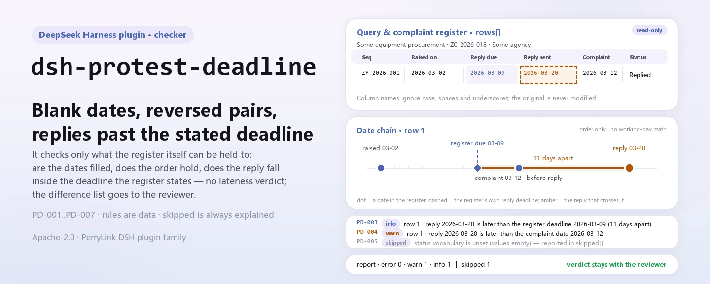
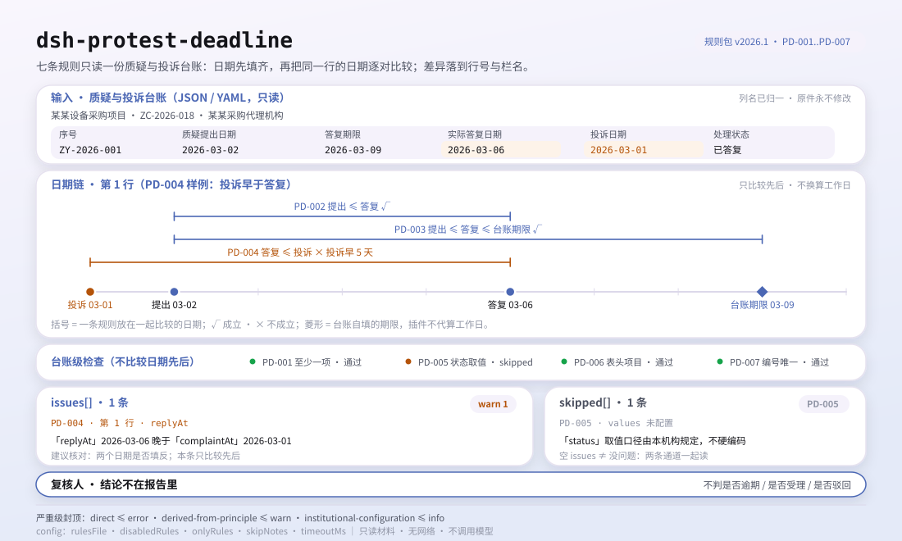

<div align="center">

<picture>
  <source media="(prefers-color-scheme: dark)" srcset="docs/assets/dsh-protest-deadline-hero-en-dark.webp">
  
</picture>

# dsh-protest-deadline

**आपत्ति-और-शिकायत रजिस्टर में छूटी तिथियों और बेक्रम तिथियों को «कौन-सी पंक्ति, कौन-सा कॉलम, क्या कम है» की सूची में बदलें — अंतिम निर्णय समीक्षक के पास रहता है।**

DeepSeek Harness के लिए केवल-डेटा जाँच प्लगइन: यह एक आपत्ति-और-शिकायत रजिस्टर (परियोजना हेडर और प्रत्येक आपत्ति की एक पंक्ति) पढ़ता है, अपने साथ आने वाले संस्करणबद्ध नियम-पैक (PD-001..PD-007) को लागू करता है, और केवल वही अंतर सूचीबद्ध करता है जिन्हें रजिस्टर के भीतर इंगित किया जा सकता है — कोई अनुपालन निर्णय नहीं, कोई दायित्व-निर्धारण नहीं।

[इंस्टॉल](#तीन-चरणों-में-शुरुआत) · [कॉन्फ़िगरेशन](#कॉन्फ़िगरेशन) · [FAQ](#faq) · [简体中文](README.md) · [English](README.en.md) · [Español](README.es.md) · [Português](README.pt.md) · [हिन्दी](README.hi.md)

[](LICENSE)
[](#संगतता)
[](https://www.npmjs.com/package/dsh-protest-deadline)
[](https://github.com/PerryLink/dsh-protest-deadline/actions/workflows/ci.yml)
[](#संगतता)

[](https://github.com/PerryLink/dsh-protest-deadline/stargazers)
[](https://www.npmjs.com/package/dsh-protest-deadline)
[](https://dshfind.com/plugins/PerryLink/dsh-protest-deadline?ref=badge)
[](https://securityscorecards.dev/viewer/?uri=github.com/PerryLink/dsh-protest-deadline)
[](https://dsh.market/)
[](https://gitee.com/perrylink/dsh-protest-deadline)

```sh
dsh plugin --profile <name> add dsh-protest-deadline
```

</div>

<sub>समुदाय प्लगइन, DeepSeek से संबद्ध नहीं। एकमात्र रेपो: <https://github.com/PerryLink/dsh-protest-deadline> (Gitee दर्पण है)।</sub>

## यह क्या है

`dsh-protest-deadline` एक आपत्ति-और-शिकायत रजिस्टर पढ़ता है — परियोजना हेडर और प्रत्येक आपत्ति की एक पंक्ति — और जाँचता है कि ऐसे रजिस्टर से यांत्रिक रूप से क्या अपेक्षित किया जा सकता है: हर पंक्ति में आपत्ति उठाने की तिथि या उत्तर की तिथि में से कम से कम एक दर्ज हो, दोनों तिथियाँ पढ़ी जा सकें और उनका क्रम बने, उत्तर रजिस्टर में ही लिखी उत्तर-समय-सीमा के भीतर हो, शिकायत की तिथि उत्तर की तिथि से पहले न हो, प्रत्येक स्थिति आपकी ही शब्दावली से हो, हेडर खरीद परियोजना का नाम दे, और आपत्ति क्रमांक दोहराए न गए हों।

यह तय नहीं करता कि आपत्ति विधिक अवधि के भीतर उठाई गई थी या नहीं, उसे स्वीकार किया जाना चाहिए या नहीं, या अस्वीकार किया जाना चाहिए या नहीं — अंतर की सूची समीक्षक के पास जाती है।

- **किसके लिए**: खरीद एजेंसियाँ, सरकारी खरीद अधिकारी और आंतरिक नियंत्रण समीक्षक; कमांड लाइन की ज़रूरत नहीं — सामग्री चैट में सौंप दें।
- **आप क्या देते हैं**: वह मूल सामग्री जिस पर जाँच चलती है (एक तालिका, रजिस्टर या दस्तावेज़); मूल कभी नहीं बदला जाता। Excel को पहले JSON/YAML में बदला जा सकता है, और प्लेटफ़ॉर्म समर्थन दे तो चैट में भी।
- **आपको क्या मिलता है**: «कौन-सी पंक्ति, कौन-सा कॉलम, क्या कम है, कैसे सुधारें» की सूची; जो जाँच नहीं चल सकी, वह कारण के साथ `skipped` में दर्ज होती है।

<picture>
  <source media="(prefers-color-scheme: dark)" srcset="docs/assets/dsh-protest-deadline-flow-v5-dark.svg">
  
</picture>

## तीन चरणों में शुरुआत

1. **इंस्टॉल करें** (कोई एक चैनल चुनें):

   ```sh
   # git चैनल (नवीनतम main; git+https://github.com/PerryLink/dsh-protest-deadline.git के बराबर)
   dsh plugin --profile <name> add github:PerryLink/dsh-protest-deadline
   # npm चैनल (प्रकाशित संस्करण)
   dsh plugin --profile <name> add dsh-protest-deadline
   # tarball चैनल: इस रेपो में pnpm pack के बाद
   dsh plugin --profile <name> add ./dsh-protest-deadline-<version>.tgz
   ```

2. **न्यूनतम कॉन्फ़िगरेशन** (डिफ़ॉल्ट ही काफ़ी हैं; `config` के बिना bundle पंक्ति सभी डिफ़ॉल्ट लेती है, और नियम-पैक का पथ साथ आए `rules/protest-deadline.yaml` की ओर जाता है):

   ```yaml
   - insert:
       - id: dsh-protest-deadline
         name: dsh-protest-deadline
   ```

3. **जाँचें कि यह माउंट हुआ**:

   ```sh
   dsh --profile <name> --dump-config | grep 'dsh-protest-deadline'
   ```

   फिर इसे एक रजिस्टर सौंपें; उदाहरण के लिए साथ आई नमूना सामग्री (अपेक्षित आउटपुट `samples/quickstart/expected/result.json` में):

   ```text
   > साथ आई नमूने पर यह जाँच चलाओ और बताओ कि कितनी समस्याएँ मिलीं और उनका स्तर क्या है।
   protest_deadline: 1 issue(s) — error 0, warn 1, info 0
   skipped: 1
   ```

   नमूना स्थानीय रूप से भी चला सकते हैं (पहले `pnpm run build` से `lib/` बनाएँ):

   ```sh
   node samples/quickstart/run.mjs --json
   ```

**अनइंस्टॉल**: `dsh plugin --profile <name> remove dsh-protest-deadline` (या प्रोफ़ाइल patch से वह पंक्ति हटा दें)।

<details>
<summary>WorkBuddy / Coze में उपयोग</summary>

WorkBuddy / Coze में «Tender Compliance Suite» खोजें (पूरा सेट; यह जाँच उसका एक भाग है; उपलब्धता सूची के अनुसार) और वही जाँच क्षमता बिना कमांड लाइन के पाएँ।

</details>

## मुख्य क्षमताएँ

`dsh-protest-deadline` `protest_deadline` टूल पंजीकृत करता है: एक रजिस्टर पढ़ता है, संस्करणबद्ध नियम-पैक लागू करता है और रिपोर्ट लौटाता है।

- **एक डेटा-पैक में सात नियम** — नियम-पैक डेटा है, कोड नहीं (`rules/protest-deadline.yaml`); उसे बदलने से पूरा नियम-समुच्चय बदल जाता है, TypeScript की एक पंक्ति छुए बिना।
- **सामग्री पर केवल पढ़ाई** — JSON या YAML स्वीकार करता है और मूल कभी नहीं बदलता; शुद्ध ESM, कोई नेटवर्क अनुरोध नहीं और कोई मॉडल कॉल नहीं।
- **कोई गढ़ा हुआ उद्धरण नहीं** — हर नियम में `document` / `number` / `clause` / `excerpt` / `kind` / `source` होता है; `excerpt` शब्दशः उद्धरण होना चाहिए, और जो नियम अभी खोजे नहीं जा सके वे `rules/citations-baseline.json` में जाते हैं, जो सूची केवल छोटी हो सकती है।
- **गंभीरता साक्ष्य के अनुसार** — `derived-from-principle` की अधिकतम सीमा `warn` है, संस्थागत कॉन्फ़िगरेशन (`institutional-configuration`) की `info`, और एक परीक्षण इसे सत्यापित करता है।
- **खाली समस्या-सूची का अर्थ «कुछ गड़बड़ नहीं» कभी नहीं** — जो जाँच नहीं चल सकी, वह कारण के साथ `skipped` में दर्ज होती है; जिस नियम की आवश्यक सूची सेट नहीं है, वह चुपचाप पास होने के बजाय स्वयं को `skipped` में दर्ज करता है।
- **कोई निर्णायक शब्दावली नहीं** — रिपोर्ट केवल अंतर गिनाती है और अनुपालन, दायित्व या सत्यता पर कभी निर्णय नहीं देती; शब्दावली-रक्षक इसे लागू करता है और हर रिपोर्ट के साथ अस्वीकरण रहता है।

| नियम | जाँच | गंभीरता | आधार प्रकार |
|---|---|---|---|
| `PD-001` | हर पंक्ति में आपत्ति की तिथि या उत्तर की तिथि दर्ज है | warn | direct |
| `PD-002` | उत्तर की तिथि आपत्ति की तिथि से पहले नहीं | warn | direct |
| `PD-003` | उत्तर दर्ज समय-सीमा के भीतर है | info | local |
| `PD-004` | शिकायत की तिथि उत्तर की तिथि से पहले नहीं | warn | direct |
| `PD-005` | स्थिति आपकी शब्दावली से है (डिफ़ॉल्ट रूप से बंद) | info | local |
| `PD-006` | हेडर खरीद परियोजना का नाम देता है (आपत्ति की तिथि वैकल्पिक) | warn | principle |
| `PD-007` | रजिस्टर में आपत्ति क्रमांक अद्वितीय हैं | warn | principle |

### उदाहरण

ये प्लगइन के वास्तविक प्रवेश-बिंदु हैं; एक बार इंस्टॉल करें और एक कॉल करें। पहली पंक्ति विस्तृत केस है, बाकी संक्षिप्त केस हैं।

**विस्तृत उदाहरण** — टूल `protest_deadline`, इनपुट:

```json
{"project":"某某设备采购项目","projectNo":"ZC-2026-018","rows":[{"序号":"ZY-2026-001","质疑人":"某某科技有限公司","质疑提出日期":"","答复收到日期":"2026-03-07","答复期限":"2026-03-09","实际答复日期":""}]}
```

आउटपुट:

```json
{
  "id": "dsh-protest-deadline.PD-001.de09b5a6",
  "ruleId": "PD-001",
  "severity": "warn",
  "locator": {
    "row": 1,
    "field": "raisedAt"
  },
  "found": "第 1 行 raisedAt、replyAt 都为空",
  "expected": "raisedAt、replyAt 至少应填写一项",
  "fix": "补填质疑提出日期与答复日期；本条只核对是否填写，不判断是否在法定期限内"
}
```

*स्रोत `dsh-protest-deadline/tests/fixtures/PD-001/PD-001-unsafe.json (cases.json expects 1×PD-001); executed parseMaterial+runCheck, checkedAt=2026-10-06T00:00:00.000Z`*

| आपका सवाल | इसका जवाब |
|---|---|
| किसी पंक्ति में आपत्ति की तिथि और उत्तर की तिथि दोनों खाली हैं। क्या यह दर्ज होता है? | हाँ। `PD-001` हर पंक्ति में `raisedAt` और `replyAt` में से कम से कम एक भरा होने की अपेक्षा करता है और जिस पंक्ति में दोनों खाली हैं उसे दर्ज करता है। यह केवल यह देखता है कि दोनों में से एक भरा है, यह नहीं कि आपत्ति विधिक अवधि के भीतर उठाई गई थी: उसके लिए आपूर्तिकर्ता को हानि का ज्ञान होने की तिथि, तामील की तिथि और कार्य-दिवसों की गणना चाहिए, जो रजिस्टर में प्रायः दर्ज नहीं होती। |
| उत्तर की तिथि आपत्ति की तिथि से पहले लिखी है। क्या यह पकड़ में आता है? | `PD-002` पंक्ति-दर-पंक्ति आपत्ति की तिथि की तुलना उत्तर की तिथि से करता है और `raisedAt` के `replyAt` से बाद का होने पर उसे दर्ज करता है; एक ही दिन बाद का नहीं माना जाता। जो मान वह पढ़ नहीं सकता — जैसे तिथि शब्दों में लिखी हो, `2026-03-15`, `2026/3/15` या `2026-03-15 09:30` की तरह नहीं — वह उसी पंक्ति में दर्ज होता है, चुपचाप छोड़ा नहीं जाता। यह नियम केवल रजिस्टर में लिखी इन दो तिथियों का क्रम देखता है। |
| हमारा उत्तर रजिस्टर में लिखी उत्तर-समय-सीमा के बाद गया। क्या वह विलंबित था? | `PD-003` कोई दिन-संख्या कठोरता से नहीं रखता और «विलंबित» नहीं कह सकता: यह वास्तविक उत्तर-तिथि की तुलना रजिस्टर के अपने `replyDueAt` कॉलम में लिखी समय-सीमा से करता है, इसलिए किसी प्रविष्टि का अर्थ है «यह आपके दर्ज की गई समय-सीमा से मेल नहीं खाता»। वह कॉलम खाली हो तो तुलना का आधार ही नहीं रहता और यह नियम `skipped` में दर्ज होता है, किसी अवधि को मान नहीं लेता। |
| स्थिति कॉलम में «उत्तर दिया गया» लिखा है, फिर भी उस पर कुछ दर्ज नहीं हुआ। क्यों? | `PD-005` स्थिति की तुलना उस शब्दावली से करता है जो आप कॉन्फ़िगर करते हैं, और `values` खाली आता है, इसलिए जैसा दिया गया है वैसा ही यह नियम चुपचाप पास होने के बजाय `skipped` में दर्ज होता है — मानों का चयन आपकी संस्था का विषय है, इंजन का नहीं। अपनी सूची (लंबित, उत्तर दिया गया, शिकायत दर्ज, वापस लिया गया, …) `values` में भरें, तब सूची में न होने वाला हर मान पंक्ति-दर-पंक्ति दर्ज होगा। यह केवल यह देखता है कि मान सूची में है, यह नहीं कि आपत्ति का निपटारा कैसे होना चाहिए। |
| हेडर परियोजना का नाम देता है, पर हेडर-स्तर पर आपत्ति की तिथि नहीं है। क्या कुछ छूटा है? | नहीं। `PD-006` हेडर में केवल खरीद परियोजना (`project`) देखता है, क्योंकि आपत्ति की तिथि सामान्यतः प्रति-पंक्ति कॉलम होती है। यदि आपके फ़ॉर्म में वह हेडर में भी दर्ज होती है, तो नियम का ही नोट कहता है कि `fields` को `[project, raisedAt]` कर दें। परियोजना का अभाव हेडर के विरुद्ध दर्ज होता है, किसी पंक्ति के विरुद्ध नहीं। |
| एक ही आपत्ति क्रमांक दो पंक्तियों में आया है। | `PD-007` दूसरी पंक्ति दर्ज करता है और पहली का उल्लेख करता है; तुलना में रिक्त स्थान नहीं गिने जाते। दोहराव का अर्थ प्रायः यह होता है कि वही आपत्ति दो बार दर्ज हुई या क्रमांक गलत लिखा गया — इन दोनों में अंतर करना मानवीय निर्णय है। रजिस्टर में क्रमांक कॉलम ही न हो तो यह नियम पास होने के बजाय बताता है कि वह लागू नहीं होता। |

## यह किन मानकों पर आधारित है

| दस्तावेज़ | संख्यांक | इन्हें उद्धृत करने वाले नियम |
|---|---|---|
| सरकारी खरीद में आपत्ति और शिकायत के निपटारे के उपाय (मानक चीनी शीर्षक `rules/evidence/` में दर्ज है) | वित्त मंत्रालय का आदेश संख्या 94 (26 दिसंबर 2017 को प्रकाशित, 1 मार्च 2018 से प्रभावी; छह अध्याय, पैंतालीस अनुच्छेद; अनुच्छेद 45 आदेश संख्या 20 को निरसित करता है, इसलिए यह पैक उसका उद्धरण कभी नहीं देता) | PD-001, PD-002, PD-003, PD-004, PD-005, PD-006, PD-007 |

**सीमा:** यह प्लगइन एक **आपत्ति-और-शिकायत रजिस्टर** की वह जाँच करता है जो यांत्रिक रूप से संभव है — प्रमुख तिथियाँ दर्ज हैं या नहीं, वे पढ़ी जा सकती हैं और क्रम बनाती हैं या नहीं, उत्तर रजिस्टर में ही लिखी समय-सीमा के भीतर है या नहीं, स्थितियाँ आपकी शब्दावली से हैं या नहीं, और आपत्ति क्रमांक अद्वितीय हैं या नहीं। यह **यह नहीं** तय करता कि आपत्ति समय पर दायर हुई थी, स्वीकार होनी चाहिए या अस्वीकार। **वे निर्णय खरीदकर्ता या वित्त विभाग, तामील की तिथियों और कार्य-दिवस आधार पर होते हैं, जो बहीखाता प्रायः दर्ज नहीं करता।**

> ### ⚠️ रिपोर्ट के किसी उद्धरण पर भरोसा करने से पहले यह पढ़ें
>
> **आदेश संख्या 94 का पाठ प्राप्त किया गया और शब्दशः पढ़ा गया** — सभी छह अध्याय और पैंतालीस अनुच्छेद — और `rules/evidence/clause-verification.md` दर्ज करता है कि क्या उद्धृत हुआ: अनुच्छेद 10 (**7 कार्य-दिवसों** में आपत्ति), अनुच्छेद 13 (**7 कार्य-दिवसों** में उत्तर), अनुच्छेद 17 (**उत्तर-अवधि समाप्त होने के बाद** 15 कार्य-दिवसों में शिकायत), अनुच्छेद 21 (5 और 8 कार्य-दिवस), अनुच्छेद 26 (30 कार्य-दिवस) और **अनुच्छेद 42**, जो दो गणना नियम तय करता है — आरंभ का दिन गिनती में नहीं और अंतिम दिन अवकाश हो तो समय-सीमा आगे बढ़ती है। अनुच्छेद 45 ने आदेश संख्या 20 को **निरसित** भी किया, इसलिए यह पैक उसका उद्धरण कभी नहीं देता। उच्चतर विधि, सरकारी खरीद अधिनियम, का पूरा पाठ भी शब्दशः पढ़ा गया (`rules/evidence/clause-verification-law.md`), और उसकी अवधियाँ आदेश से पूरी तरह मेल खाती हैं।
>
> **हर नियम का `excerpt` अब शब्दशः उद्धरण है।** पुराने संस्करण में `excerpt` के भीतर «प्राप्त नहीं» लिखा था; 2026-10-07 को उद्धरण भर दिए गए और `check:citations` यह अनुशासन बनाए रखता है। हर नियम की गंभीरता अब भी `warn` या `info` है। यह प्लगइन आंतरिक रजिस्टर की तिथियों और कॉलमों की जाँच करता है; आदेश यह नियंत्रित करता है कि खरीदकर्ता और वित्त विभाग कैसे कार्य करें। खाली कॉलम को «7 कार्य-दिवसों में उत्तर देना होगा» का `direct` उल्लंघन कहना, दर्ज करने की कमी को नियामक उल्लंघन बना देना होगा।
>
> **यह प्लगइन कोई दिन-संख्या कठोरता से नहीं रखता, और पाठ ही इसका कारण बताता है।** अवधियाँ **कार्य-दिवसों** में चलती हैं, अनुच्छेद 42 आरंभ के दिन को गिनती से बाहर रखता है और अंतिम दिन अवकाश हो तो समय-सीमा आगे बढ़ाता है, और अनुच्छेद 17 शिकायत की घड़ी **उत्तर-अवधि की समाप्ति** से शुरू करता है, उत्तर की तिथि से नहीं — जबकि रजिस्टर प्रायः केवल कैलेंडर तिथियाँ दर्ज करता है। इसलिए `PD-003` वास्तविक उत्तर-तिथि की तुलना **रजिस्टर के अपने `replyDueAt` कॉलम में लिखी** समय-सीमा से करता है, और वह कॉलम खाली हो तो स्वयं को `skipped` में दर्ज करता है। उसका निष्कर्ष कहता है «यह आपके दर्ज किए गए समय से मेल नहीं खाता», **न** कि «उत्तर विलंबित है»।

## कॉन्फ़िगरेशन

सभी समायोज्य पैरामीटर `src/config.ts` में Schemastery `Config` फ़ील्ड हैं (cordis.yml से बदले जा सकते हैं); प्रति-नियम सीमाएँ `rules/` के नियम-पैक में हैं। id-आधारित ओवरराइड पूरी पंक्ति बदल देता है — जिन कुंजियों की आवश्यकता हो, सब दोहराएँ।

| कुंजी | प्रकार | डिफ़ॉल्ट | विवरण |
|---|---|---|---|
| `rulesFile` | string | `rules/protest-deadline.yaml` | नियम-पैक का पथ, पैकेज रूट के सापेक्ष |
| `disabledRules` | string[] | `[]` | बंद करने वाले नियम id; प्रत्येक `skipped` में दिखता है |
| `onlyRules` | string[] | `[]` | केवल ये नियम चलाएँ; खाली होने पर सभी नियम चलते हैं |
| `skipNotes` | string | `""` | हर `skipped` कारण के आगे जोड़ी जाने वाली टिप्पणी |
| `timeoutMs` | number | `120000` | उपकरण का सहकारी समय-सीमा बजट |

नियम-स्तरीय पैरामीटर जो जानना उपयोगी है:

- `PD-003` रजिस्टर का `replyDueAt` कॉलम पढ़ता है। वह समय-सीमा आदेश संख्या 94 (कार्य-दिवस, आरंभ दिन और आगे बढ़ना) के अनुसार निकालकर बहीखाते में लिखें; प्लगइन उसे स्वयं नहीं निकालेगा।
- `PD-005` `values` — आपकी स्थिति शब्दावली, जैसे `[लंबित, उत्तर दिया गया, शिकायत दर्ज, निपटाया गया, वापस लिया गया]`।
- `PD-002` और `PD-004` तिथि-जोड़ों की तुलना करते हैं; उत्तर→शिकायत दिशा भी जाँचनी हो तो `field: replyAt` और `notAfterField: complaintAt` के साथ दूसरा नियम जोड़ें।

प्रोफ़ाइल patch में ओवरराइड का उदाहरण:

```yaml
- insert:
    - id: dsh-protest-deadline
      name: dsh-protest-deadline
      config:
        disabledRules: [PD-005]
        timeoutMs: 180000
```

## सामग्री का प्रारूप

टूल JSON या YAML स्वीकार करता है:

```yaml
project: 某某设备采购项目
projectNo: ZC-2026-018
agency: 某某采购代理机构
rows:
  - { 序号: ZY-2026-001, 质疑人: 某某科技有限公司, 质疑提出日期: 2026-03-02,
      答复期限: 2026-03-09, 实际答复日期: 2026-03-06, 投诉日期: 2026-03-12, 处理状态: 已答复 }
```

कॉलम नाम बिना केस-भेद और रिक्त स्थान, अंडरस्कोर व हाइफ़न छोड़कर मिलाए जाते हैं; रजिस्टर के अपने कॉलम नाम सुरक्षित रहते हैं, इसलिए निष्कर्ष उसी कॉलम का नाम लेता है जो उसने पढ़ा। तिथियाँ `2026-03-02` या `2026-03-02 09:30` के रूप में लिखी जा सकती हैं। पढ़ने की परत में फ़ील्ड वैकल्पिक हैं और जाँच इंजन उन्हें सत्यापित करता है, इसलिए आंशिक निर्यात पर क्रैश के बजाय «अनुपस्थित» श्रेणी के निष्कर्ष मिलते हैं।

## नियमों का स्रोत

नियम-डेटा `rules/protest-deadline.yaml` में कोड से अलग रहता है: प्रत्येक नियम में दस्तावेज़, संख्या, स्रोत की अपनी क्रमांकन-प्रणाली के अनुसार धारा, शब्दशः उद्धरण और स्रोत URL होता है। लोड-समय रक्षक लागू करता है कि उद्धरण कम से कम आठ अक्षरों का वास्तविक उद्धरण हो; जिस जाँच का आधार केवल सिद्धांत (`kind: derived-from-principle`, अधिकतम `warn`) या संस्थागत कॉन्फ़िगरेशन (`kind: institutional-configuration`, अधिकतम `info`) हो, उसे कभी `error` नहीं कहा जा सकता। अपने आधार को बढ़ा-चढ़ाकर बताने वाला पैक लोड पर विफल होता है, भरोसेमंद दिखने वाली रिपोर्ट देने के बजाय।

सत्यापन के दौरान तय हुई सीमाएँ और जान-बूझकर **न** कहे गए निष्कर्ष `rules/evidence/` में हैं (आदेश के लिए एक रिपोर्ट, उच्चतर विधि के लिए एक)।

## FAQ

<details>
<summary>क्या यह हमारी ओर से अनुपालन तय करता है?</summary>

नहीं। यह केवल सामग्री के भीतर इंगित किए जा सकने वाले अंतर गिनाता है (कौन-सी पंक्ति, कौन-सा कॉलम, क्या कम है, कैसे सुधारें) और तथ्य या अनुपालन तय नहीं करता — निष्कर्ष सदा समीक्षक के पास रहता है। शब्दावली-रक्षक रिपोर्ट की भाषा लागू करता है और हर रिपोर्ट के साथ अस्वीकरण रहता है।

</details>

<details>
<summary>मेरा रजिस्टर Excel फ़ाइल है। क्या सीधे उपयोग कर सकता हूँ?</summary>

हाँ — पहले उसे JSON या YAML में बदलें; प्लेटफ़ॉर्म समर्थन दे तो चैट में रूपांतरण हो सकता है। टूल केवल सामग्री पढ़ता है और मूल कभी नहीं बदलता।

</details>

<details>
<summary>`PD-005` कभी कुछ क्यों नहीं बताता?</summary>

क्योंकि पैक में कोई स्थिति-शब्दावली नहीं आती: `values` डिफ़ॉल्ट रूप से खाली है, इसलिए नियम स्वयं को `skipped` में दर्ज करता है। `values` में अपनी संस्था की स्थिति-लिपियाँ भरें, तब नियम यह जाँचने लगता है कि दर्ज स्थिति सूची में है; फिर भी यह नहीं तय करता कि आपत्ति का निपटारा कैसे होना चाहिए।

</details>

<details>
<summary>क्या खाली `issues` सूची को «कुछ गड़बड़ नहीं» माना जा सकता है?</summary>

नहीं। जो जाँच नहीं चल सकी, वह कारण के साथ `skipped` में दिखती है (खाली स्थिति-शब्दावली, अनुपस्थित कॉलम, खाली उत्तर-समय-सीमा)। रिपोर्ट से कोई निष्कर्ष निकालने से पहले `issues` और `skipped` दोनों पढ़ें।

</details>

<details>
<summary>`PD-003` «विलंबित» के बजाय «मेल नहीं खाता» क्यों कहता है?</summary>

क्योंकि यह केवल वास्तविक उत्तर-तिथि की तुलना रजिस्टर के अपने `replyDueAt` में लिखी समय-सीमा से करता है। विधिक उत्तर-अवधि कार्य-दिवसों में चलती है और उसके अपने आरंभ-दिन व आगे बढ़ने के नियम हैं, जबकि रजिस्टर प्रायः कैलेंडर तिथियाँ दर्ज करता है; प्लगइन कैलेंडर दिनों को कार्य-दिवसों में नहीं बदलता और न ही आपके लिए कोई समय-सीमा मान लेता है। निष्कर्ष का अर्थ है «यह आपके दर्ज किए गए समय से मेल नहीं खाता»।

</details>

<details>
<summary>क्या सामग्री इंटरनेट पर जाती है या प्रशिक्षण में उपयोग होती है?</summary>

नहीं। प्लगइन नेटवर्क का उपयोग नहीं करता, मॉडल को कॉल नहीं करता, केवल सामग्री पढ़ता है और मूल में कभी नहीं लिखता; रिपोर्ट स्थानीय रूप से बनती है।

</details>

## सुरक्षा सीमाएँ

- **सामग्री पर केवल पढ़ाई।** टूल आपके दिए फ़ाइल या इनलाइन पाठ को पढ़ता है और मूल कभी नहीं बदलता; कोई लेखन-पथ नहीं और कोई दूसरी प्रतिलिपि नहीं।
- **कोई नेटवर्क नहीं, कोई मॉडल कॉल नहीं।** जाँच स्वयं स्थानीय कॉलम-मिलान और तिथि-तुलना है; `package.json` का `dsh.demo` भी `network` को `false` और `writes` को खाली बताता है।
- **कोई निर्णायक शब्दावली नहीं।** रिपोर्ट अनुपालन, दायित्व या सत्यता पर कभी निर्णय नहीं देती; शब्दावली-रक्षक इसे लागू करता है और हर रिपोर्ट के साथ अस्वीकरण रहता है।
- **कोई गढ़ा हुआ उद्धरण नहीं।** `excerpt` शब्दशः उद्धरण होना चाहिए जो `rules/evidence/` में मिले; जो नियम खोजे नहीं जा सकते वे `citations-baseline.json` में जाते हैं, जो सूची केवल छोटी हो सकती है।
- **बंद रूप में विफल।** सीमा से बाहर गंभीरता, अनुपस्थित आवश्यक सूचियाँ और लोड न होने वाले नियम-पैक लोड या निष्पादन के समय स्पष्ट त्रुटि देते हैं, भरोसेमंद दिखने वाली खाली रिपोर्ट के बजाय।

## ज्ञात सीमाएँ

- **कोई दिन-संख्या कठोरता से नहीं रखी गई।** विधिक उत्तर-अवधि कार्य-दिवसों में चलती है और अनुच्छेद 42 के आरंभ-दिन व आगे बढ़ने के नियमों के अधीन है, इसलिए `PD-003` केवल रजिस्टर के अपने `replyDueAt` से तुलना करता है; वह कॉलम खाली हो तो `skipped` में चला जाता है।
- **तिथियाँ संख्यात्मक होनी चाहिए।** `2026-03-02` और `2026-03-02 09:30` पढ़ी जाती हैं; शब्दों में लिखी तिथि अपठनीय बताई जाती है — जान-बूझकर, ताकि अनुमान न लगे।
- **`PD-005` डिफ़ॉल्ट रूप से निष्क्रिय है।** स्थिति-मान संस्थाओं में बदलते हैं, इसलिए प्लगइन कोई स्थिति-सूची नहीं देता।
- **केवल रजिस्टर के फ़ील्ड।** यह तामील की तिथियाँ, अनुलग्नक, समीक्षा प्रक्रिया या आपत्ति/शिकायत के सार की जाँच नहीं करता।
- **केवल JSON या YAML।** Excel और अन्य प्रारूप पहले बदलने होंगे; टूल बाइनरी स्प्रेडशीट नहीं पढ़ता।
- **साक्ष्य की कमियाँ घोषित हैं।** सरकारी खरीद अधिनियम की जो प्रति पढ़ी गई वह 2002 का प्रकाशित पाठ था; 2014 का संशोधन प्राप्त नहीं हुआ, इसलिए «वर्तमान प्रभावशीलता» पर कोई दावा नहीं किया जाता।
- **`timeoutMs` सहकारी बजट है।** यह टूल की प्रतीक्षा सीमा तय करता है, कठोर व्यवधान नहीं; बहुत बड़े रजिस्टर फिर भी बैच में दें।

## अन्य DSH प्लगइनों के साथ इंटरऑपरेबिलिटी

प्लगइन एक ही टूल-नाम लेता है और किसी कमांड, इवेंट या UI स्थान के लिए प्रतिस्पर्धा नहीं करता:

- **केवल एक टूल।** टूल का नाम `protest_deadline` है; यह कोई कमांड, क्लाइंट slot या `webServer` उपसर्ग पंजीकृत नहीं करता। यदि यह आपके किसी टूल से टकराए, तो यह पंक्ति हटाकर अनइंस्टॉल करें।
- **केवल `tools` सेवा घोषित।** `inject` में केवल `tools` है, इसलिए सेवा-कुंजी का कोई टकराव नहीं।
- **कोई इवेंट नहीं सुनता।** `agent/pre-step` या `tools/post-execute` जैसे कोई श्रोता नहीं, इसलिए यह किसी साझा इवेंट-श्रृंखला में न घुसता है न उसे काटता है।
- **patch केवल अपनी पंक्ति `insert` करता है।** bundle परत किसी अंतर्निहित पंक्ति का `config` कभी नहीं लिखती और globals या `process.env` नहीं बदलती।

## संगतता

| सतह | स्थिति |
|---|---|
| Harness | peer रेंज `>=0.1.2-rc.1 <0.2.0 \|\| >=0.2.0-0 <0.3.0` — `0.2.0-rc.2` और `0.2.1-rc.2` दोनों को स्वीकार करने के लिए सत्यापित। `engines.dsh` `>=0.2.1-0 <0.3.0` के रूप में घोषित है और 0.2.1 से होस्ट इसे लागू करता है |
| Node | `^22.19.0 \|\| >=24.0.0` |
| प्लेटफ़ॉर्म | सभी (शुद्ध ESM; कोई नेटिव कोड नहीं, कोई नेटवर्क नहीं, कोई मॉडल कॉल नहीं) |
| टूल मोड | `native` और `ptc` दोनों में काम करता है; पूरे फ़ोल्डर के लिए `ptc` चुनें, जहाँ schema लागत एक बार चुकाई जाती है |

## समस्या निवारण

- **`PD-003` स्वयं को skipped बताता है।** रजिस्टर में उत्तर-समय-सीमा दर्ज नहीं है। यह जान-बूझकर है: विधिक अवधि कार्य-दिवसों में गिनी जाती है और प्लगइन कैलेंडर तिथियों को उसमें नहीं बदलता।
- **`PD-003` चलता है पर मुझे उत्तर समय पर लगता है।** रजिस्टर का `replyDueAt` वास्तविक उत्तर-तिथि से मेल नहीं खाता: या तो समय-सीमा कॉलम गलत निकाला गया, या उत्तर-तिथि गलत है।
- **`PD-005` कभी नहीं चलता।** उसकी स्थिति-शब्दावली खाली है; उसे अपने रजिस्टर की स्थिति-मानों से भरें।
- **`PD-002` उन तिथियों पर चलता है जो मैं पढ़ सकता हूँ।** पाठक `2026-03-02` और `2026-03-02 09:30` स्वीकार करता है; शब्दों में लिखी तिथि जान-बूझकर अपठनीय बताई जाती है।
- **प्लगइन इंस्टॉल हो गया पर टूल दिखता नहीं।** जाँचें कि `main` `lib/index.mjs` पर जाता है और `pnpm run build` ने उसे बनाया है; गलत `main` लोडर को प्रविष्टि चुपचाप छोड़ने पर मजबूर करता है।
- **`dsh plugin add` असंगत बताकर मना करता है।** peer रेंज `0.1.x` और `0.2.x` दोनों को कवर करती है; बाहर होने पर स्पष्ट छूट दें: `dsh plugin --profile <name> allow-version dsh-protest-deadline@0.1.0 --dsh-version <runtime> --accept-risk`
- **`check` में `manifest-peers` विफल दिखता है।** स्थिर जाँचकर्ता 0.2 पंक्ति से पहले की कठोर peer रेंज से तुलना करता है। रनटाइम इंस्टॉल के समय peer-संगतता लागू करता है, इसलिए घोषित रेंज सही है; यह `dsh-plugin-dev` की ज्ञात अपस्ट्रीम समस्या है।
- **समय खिसका हुआ लगता है।** सारी गणना दिए गए स्ट्रिंग पर वॉल-क्लॉक है, कोई समय-क्षेत्र रूपांतरण नहीं।

## इकोसिस्टम और गुणवत्ता

- [Gitee दर्पण](https://gitee.com/perrylink/dsh-protest-deadline) (समकालिक दर्पण; GitHub मानक है)
- [dshfind प्लगइन पृष्ठ](https://dshfind.com/plugins/PerryLink/dsh-protest-deadline) (इंस्टॉल और रैंकिंग)
- [OpenSSF Scorecard रिपोर्ट](https://securityscorecards.dev/viewer/?uri=github.com/PerryLink/dsh-protest-deadline) ([.github/workflows/scorecard.yml](.github/workflows/scorecard.yml) से संचालित)
- [DSH Market](https://dsh.market/) (सूचीबद्ध)
- **1024 स्टोर चैनल**: एक बार `npm i -g dsh1024`, फिर `dsh1024 plugin --profile <name> add dsh-protest-deadline` ([deepseek1024.com](https://deepseek1024.com) की इंस्टॉल रैंकिंग में गिना जाता है)
- [इकोसिस्टम ज्ञान-आधार](https://perrylink.github.io/dsh-plugin-guide/) — प्लगइन विकास गाइड · चयन-डेटा · रखरखाव मानदंड

## डेवलपमेंट

```sh
pnpm install                                        # node ^22.19 || >=24
pnpm run typecheck                                  # tsc --noEmit
pnpm test                                           # vitest: साझा टेबल-प्लगइन सूट + युग्मित fixtures
pnpm run build                                      # tsdown -> lib/index.mjs + lib/index.d.mts
pnpm run verify:self-contained                      # निर्भरताएँ registry से हल होती हैं
pnpm run check:lockfile                             # lockfile विचलन जाँच
pnpm run check:readmes                              # पाँच-भाषा README स्थिरता
pnpm run check:citations                            # नियम-पैक उद्धरण आधार-रेखा
node ../scripts/sync-shared.mjs dsh-protest-deadline  # ../_shared से src/shared ताज़ा करें
pnpm pack                                           # प्रकाशित tarball
```

प्लगइन **केवल-डेटा** है: `src/model.ts` तालिका का आकार घोषित करता है, साझा किट पाठक और जाँच-इंजन देता है, और नियम-पैक हर जाँच घोषित करता है। स्थानीय नमूना रन (पहले `pnpm run build` से `lib/` बनाएँ):

```sh
node samples/quickstart/run.mjs --json
# => {"tool":"protest_deadline","issueCount":1,"summary":{"error":0,"warn":1,"info":0},"skippedCount":1}
```

नमूना इनपुट `samples/quickstart/input/` में, अपेक्षित आउटपुट `samples/quickstart/expected/result.json` में और स्क्रीनशॉट `docs/assets/quickstart.png` में है। README चित्र [`scripts/gen-readme-assets.py`](scripts/gen-readme-assets.py) (Python + Pillow) से क्रमादेशित रूप से बनते हैं और स्क्रिप्ट दोबारा चलाई जा सकती है; पुराना एकल-संस्करण प्रवाह आरेख और डेमो चित्र बाहरी लिंक के लिए `docs/assets/` में रहते हैं, जबकि README केवल नए हल्के/गहरे युग्म का संदर्भ देते हैं।

Topics: `deepseek-harness`, `dsh`, `dsh-plugin`, `cordis`, `protest`, `deadline`

## परिवार और आभार

यह परियोजना [PerryLink](https://github.com/PerryLink) द्वारा रखरखाव किए जाने वाले DeepSeek Harness प्लगइन परिवार का सदस्य है (सभी Apache-2.0)। पूरा परिवार सूचकांक: [सामग्री के अनुसार जाँचक चुनें](https://perrylink.github.io/zh/checkers/choose/)। अगर यह उपयोगी लगे, तो **एक star अगले व्यक्ति को इसे खोजने में मदद करता है** — इसके पीछे कोई सुविधा नहीं है।

- [@PerryLink](https://github.com/PerryLink) — निर्माता और रखरखावकर्ता: केवल-डेटा नियम-पैक (PD-001..PD-007), `protest_deadline` टूल, उद्धरण-सत्यापन रिकॉर्ड और पाँच-भाषा दस्तावेज़।

<details>
<summary>सभी प्लगइन विस्तारित करें</summary>

| प्लगइन | स्थिति |
|---|---|
| **[dsh-aqua-input-check](https://github.com/PerryLink/dsh-aqua-input-check)** |  |
| **[dsh-archive-check](https://github.com/PerryLink/dsh-archive-check)** |  |
| **[dsh-auto-review](https://github.com/PerryLink/dsh-auto-review)** |  |
| **[dsh-autotier](https://github.com/PerryLink/dsh-autotier)** | 🧊 फ़्रोज़न — रेपो README देखें |
| **[dsh-bid-ca-precheck](https://github.com/PerryLink/dsh-bid-ca-precheck)** |  |
| **[dsh-bid-qual-check](https://github.com/PerryLink/dsh-bid-qual-check)** |  |
| **[dsh-cert-mcp](https://github.com/PerryLink/dsh-cert-mcp)** | 🧊 फ़्रोज़न — रेपो README देखें |
| **[dsh-checkpoint-rewind](https://github.com/PerryLink/dsh-checkpoint-rewind)** |  |
| **[dsh-click](https://github.com/PerryLink/dsh-click)** |  |
| **[dsh-composer-history](https://github.com/PerryLink/dsh-composer-history)** |  |
| **[dsh-contract-stance](https://github.com/PerryLink/dsh-contract-stance)** |  |
| **[dsh-customs-doc-check](https://github.com/PerryLink/dsh-customs-doc-check)** |  |
| **[dsh-data-quality](https://github.com/PerryLink/dsh-data-quality)** | 🧊 फ़्रोज़न — रेपो README देखें |
| **[dsh-demurrage-ledger](https://github.com/PerryLink/dsh-demurrage-ledger)** |  |
| **[dsh-doublecheck](https://github.com/PerryLink/dsh-doublecheck)** |  |
| **[dsh-drill-script-check](https://github.com/PerryLink/dsh-drill-script-check)** |  |
| **[dsh-eia-guide-check](https://github.com/PerryLink/dsh-eia-guide-check)** |  |
| **[dsh-emergency-plan](https://github.com/PerryLink/dsh-emergency-plan)** |  |
| **[dsh-essay-rubric-check](https://github.com/PerryLink/dsh-essay-rubric-check)** |  |
| **[dsh-evidence-check](https://github.com/PerryLink/dsh-evidence-check)** |  |
| **[dsh-export-ctl-check](https://github.com/PerryLink/dsh-export-ctl-check)** |  |
| **[dsh-fast](https://github.com/PerryLink/dsh-fast)** |  |
| **[dsh-fmea-table-check](https://github.com/PerryLink/dsh-fmea-table-check)** |  |
| **[dsh-forecast-penalty](https://github.com/PerryLink/dsh-forecast-penalty)** |  |
| **[dsh-fund-research](https://github.com/PerryLink/dsh-fund-research)** |  |
| **[dsh-github](https://github.com/PerryLink/dsh-github)** |  |
| **[dsh-gongwen-flow-check](https://github.com/PerryLink/dsh-gongwen-flow-check)** |  |
| **[dsh-gongwen-word-check](https://github.com/PerryLink/dsh-gongwen-word-check)** |  |
| **[dsh-guard-plan-qc](https://github.com/PerryLink/dsh-guard-plan-qc)** |  |
| **[dsh-hazchem-check](https://github.com/PerryLink/dsh-hazchem-check)** |  |
| **[dsh-hazplan-check](https://github.com/PerryLink/dsh-hazplan-check)** |  |
| **[dsh-hidden-risk-map](https://github.com/PerryLink/dsh-hidden-risk-map)** |  |
| **[dsh-hs-classify](https://github.com/PerryLink/dsh-hs-classify)** |  |
| **[dsh-icd-rule-check](https://github.com/PerryLink/dsh-icd-rule-check)** |  |
| **[dsh-industry-research](https://github.com/PerryLink/dsh-industry-research)** |  |
| **[dsh-lawcite-adapter](https://github.com/PerryLink/dsh-lawcite-adapter)** |  |
| **[dsh-laya](https://github.com/PerryLink/dsh-laya)** |  |
| **[dsh-lc-doc-check](https://github.com/PerryLink/dsh-lc-doc-check)** |  |
| **[dsh-learning-gap-check](https://github.com/PerryLink/dsh-learning-gap-check)** |  |
| **[dsh-library](https://github.com/PerryLink/dsh-library)** |  |
| **[dsh-local-ai](https://github.com/PerryLink/dsh-local-ai)** |  |
| **[dsh-lsp-actions](https://github.com/PerryLink/dsh-lsp-actions)** |  |
| **[dsh-mask](https://github.com/PerryLink/dsh-mask)** |  |
| **[dsh-mcp-panel](https://github.com/PerryLink/dsh-mcp-panel)** |  |
| **[dsh-medrec-qc](https://github.com/PerryLink/dsh-medrec-qc)** |  |
| **[dsh-memento](https://github.com/PerryLink/dsh-memento)** | 🧊 फ़्रोज़न — रेपो README देखें |
| **[dsh-nsfc-form-check](https://github.com/PerryLink/dsh-nsfc-form-check)** |  |
| **[dsh-nurse-record-check](https://github.com/PerryLink/dsh-nurse-record-check)** |  |
| **[dsh-observe](https://github.com/PerryLink/dsh-observe)** |  |
| **[dsh-origin-rvc-check](https://github.com/PerryLink/dsh-origin-rvc-check)** |  |
| **[dsh-ota-review-check](https://github.com/PerryLink/dsh-ota-review-check)** |  |
| **[dsh-output-styles](https://github.com/PerryLink/dsh-output-styles)** |  |
| **[dsh-paper-doc-adapter](https://github.com/PerryLink/dsh-paper-doc-adapter)** |  |
| **[dsh-permission-rules](https://github.com/PerryLink/dsh-permission-rules)** |  |
| **[dsh-permit-report-check](https://github.com/PerryLink/dsh-permit-report-check)** |  |
| **[dsh-pipeline-check](https://github.com/PerryLink/dsh-pipeline-check)** |  |
| **[dsh-pleading-draft](https://github.com/PerryLink/dsh-pleading-draft)** |  |
| **[dsh-plugin-doctor](https://github.com/PerryLink/dsh-plugin-doctor)** | 🚫 रिटायर्ड (रेपो संग्रहीत) |
| **[dsh-plugin-guide](https://github.com/PerryLink/dsh-plugin-guide)** |  |
| **[dsh-plugin-kit](https://github.com/PerryLink/dsh-plugin-kit)** | 🚫 रिटायर्ड (रेपो संग्रहीत) |
| **[dsh-plugin-upgrade](https://github.com/PerryLink/dsh-plugin-upgrade)** | 🚫 रिटायर्ड (रेपो संग्रहीत) |
| **[dsh-policy-brief-draft](https://github.com/PerryLink/dsh-policy-brief-draft)** |  |
| **[dsh-power-loss-split](https://github.com/PerryLink/dsh-power-loss-split)** |  |
| **[dsh-power-ticket-check](https://github.com/PerryLink/dsh-power-ticket-check)** |  |
| **[dsh-ppap-check](https://github.com/PerryLink/dsh-ppap-check)** |  |
| **[dsh-protest-deadline](https://github.com/PerryLink/dsh-protest-deadline)** |  |
| **[dsh-railway-window](https://github.com/PerryLink/dsh-railway-window)** |  |
| **[dsh-repair-order-qc](https://github.com/PerryLink/dsh-repair-order-qc)** |  |
| **[dsh-research-report](https://github.com/PerryLink/dsh-research-report)** |  |
| **[dsh-review-reply-check](https://github.com/PerryLink/dsh-review-reply-check)** |  |
| **[dsh-rulefile-check](https://github.com/PerryLink/dsh-rulefile-check)** |  |
| **[dsh-safety-brief-check](https://github.com/PerryLink/dsh-safety-brief-check)** |  |
| **[dsh-score](https://github.com/PerryLink/dsh-score)** | 🧊 फ़्रोज़न — रेपो README देखें |
| **[dsh-session-sync](https://github.com/PerryLink/dsh-session-sync)** |  |
| **[dsh-site-log-check](https://github.com/PerryLink/dsh-site-log-check)** |  |
| **[dsh-skill-pack-security](https://github.com/PerryLink/dsh-skill-pack-security)** |  |
| **[dsh-soe-decision-check](https://github.com/PerryLink/dsh-soe-decision-check)** |  |
| **[dsh-soilwater-check](https://github.com/PerryLink/dsh-soilwater-check)** |  |
| **[dsh-sop-sync-check](https://github.com/PerryLink/dsh-sop-sync-check)** |  |
| **[dsh-spc-gbt-adapter](https://github.com/PerryLink/dsh-spc-gbt-adapter)** |  |
| **[dsh-talk](https://github.com/PerryLink/dsh-talk)** |  |
| **[dsh-tender-extract](https://github.com/PerryLink/dsh-tender-extract)** |  |
| **[dsh-tender-matrix](https://github.com/PerryLink/dsh-tender-matrix)** |  |
| **[dsh-test-drive](https://github.com/PerryLink/dsh-test-drive)** |  |
| **[dsh-ticktick](https://github.com/PerryLink/dsh-ticktick)** | 🚫 रिटायर्ड (रेपो संग्रहीत) |
| **[dsh-translate](https://github.com/PerryLink/dsh-translate)** |  |
| **[dsh-warranty-calc](https://github.com/PerryLink/dsh-warranty-calc)** |  |
| **[dsh-budget](https://github.com/PerryLink/dsh-budget)** | 🧊 फ़्रोज़न — रेपो README देखें |
| **[dsh-claude-move](https://github.com/PerryLink/dsh-claude-move)** | 🧊 फ़्रोज़न — रेपो README देखें |
| **[dsh-defend](https://github.com/PerryLink/dsh-defend)** | 🧊 फ़्रोज़न — रेपो README देखें |
| **[dsh-draw](https://github.com/PerryLink/dsh-draw)** | 🧊 फ़्रोज़न — रेपो README देखें |
| **[dsh-reach](https://github.com/PerryLink/dsh-reach)** | 🧊 फ़्रोज़न — रेपो README देखें |
| **[dsh-background-agents](https://github.com/PerryLink/dsh-background-agents)** | 🚫 रिटायर्ड (रेपो संग्रहीत) |
| **[dsh-session-pin](https://github.com/PerryLink/dsh-session-pin)** | 🚫 रिटायर्ड (रेपो संग्रहीत) |
| **[dsh-team-rooms](https://github.com/PerryLink/dsh-team-rooms)** | 🚫 रिटायर्ड (रेपो संग्रहीत) |

</details>

## लाइसेंस

[LICENSE](LICENSE) (Apache License 2.0) © 2026 dsh-protest-deadline contributors

<p align="center"><sub>Apache-2.0 · समुदाय प्लगइन, DeepSeek से संबद्ध नहीं।</sub></p>
