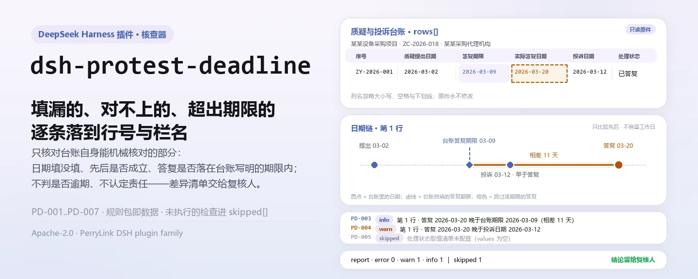
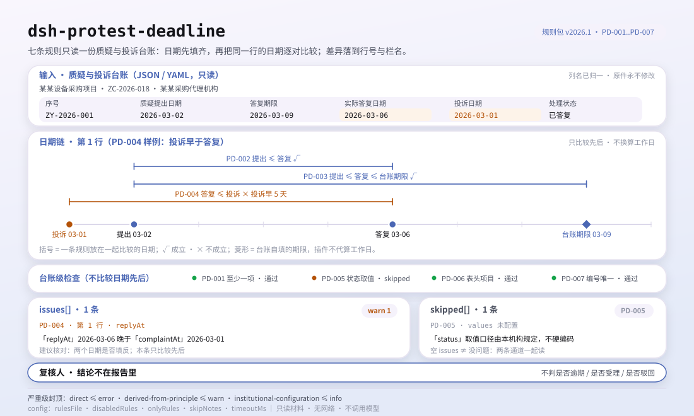

<div align="center">

<picture>
  <source media="(prefers-color-scheme: dark)" srcset="docs/assets/dsh-protest-deadline-hero-zh-dark.webp">
  
</picture>

# dsh-protest-deadline

**把质疑与投诉台账里填漏的日期、对不上的先后、超出你自填期限的答复，逐条列成「哪一行、哪一栏、差什么」的清单。**

面向 DeepSeek Harness 的数据型核查插件：读取一份质疑与投诉台账（项目表头加每条质疑一行），按随包的版本化规则包（PD-001..PD-007）逐条核对，只列台账内部能指认的差异，不判合规、不认定责任。

[安装](#三步上手) · [配置](#配置) · [FAQ](#faq) · [简体中文](README.md) · [English](README.en.md)

[](LICENSE)
[](#兼容性)
[](https://www.npmjs.com/package/dsh-protest-deadline)
[](https://github.com/PerryLink/dsh-protest-deadline/actions/workflows/ci.yml)
[](#兼容性)

[](https://github.com/PerryLink/dsh-protest-deadline/stargazers)
[](https://www.npmjs.com/package/dsh-protest-deadline)
[](https://dshfind.com/plugins/PerryLink/dsh-protest-deadline?ref=badge)
[](https://securityscorecards.dev/viewer/?uri=github.com/PerryLink/dsh-protest-deadline)
[](https://dsh.market/)
[](https://gitee.com/perrylink/dsh-protest-deadline)

```sh
dsh plugin --profile <name> add dsh-protest-deadline
```

</div>

<sub>社区插件，与 DeepSeek 官方无关。唯一仓库：<https://github.com/PerryLink/dsh-protest-deadline>（Gitee 为镜像）。</sub>

## 它是什么

`dsh-protest-deadline` 读取一份质疑与投诉台账——项目表头加每条质疑一行——核对这份台账自身能被机械核对的部分：质疑提出日期或答复日期是否至少填写一项、两个日期的先后是否成立、答复是否落在台账自己写明的答复期限内、投诉日期是否早于答复日期、处理状态是否取自本机构口径、表头是否写明采购项目、质疑函编号是否唯一。

它不判定质疑是否在法定期限内提出、是否应当受理、是否应当驳回——差异清单交给复核人。

- **给谁用**：招标代理、政府采购经办与内控审核；不用懂命令行，在对话里把材料交给它即可。
- **你交什么**：这项核对用到的原始材料（表格、清单或文书）；不改原件。Excel 可先转成 JSON/YAML，对话里也能代转。
- **它交什么**：一份「哪一行、哪一栏、差什么、怎么补」的清单；没能执行的检查逐条列入 `skipped` 并写明原因。

<picture>
  <source media="(prefers-color-scheme: dark)" srcset="docs/assets/dsh-protest-deadline-flow-v5-dark.svg">
  
</picture>

## 三步上手

1. **安装**（三选一）：

   ```sh
   # git 通道（最新 main；等价于 git+https://github.com/PerryLink/dsh-protest-deadline.git）
   dsh plugin --profile <name> add github:PerryLink/dsh-protest-deadline
   # npm 通道（已发布版本）
   dsh plugin --profile <name> add dsh-protest-deadline
   # tarball 通道：本仓库 pnpm pack 后
   dsh plugin --profile <name> add ./dsh-protest-deadline-<version>.tgz
   ```

2. **最小配置**（默认即可用；bundle 行不带 `config` 时全部走默认值，规则包路径指向随包的 `rules/protest-deadline.yaml`）：

   ```yaml
   - insert:
       - id: dsh-protest-deadline
         name: dsh-protest-deadline
   ```

3. **验证已生效**：

   ```sh
   dsh --profile <name> --dump-config | grep 'dsh-protest-deadline'
   ```

   然后把一份台账交给它，例如用仓内自带样例（期望输出在 `samples/quickstart/expected/result.json`）：

   ```text
   > 用自带样例跑一次这项检查，告诉我发现了几条问题、分别是什么级别。
   protest_deadline: 1 issue(s) — error 0, warn 1, info 0
   skipped: 1
   ```

   也可以先本地试跑（需先 `pnpm run build` 产出 `lib/`）：

   ```sh
   node samples/quickstart/run.mjs --json
   ```

**卸载**：`dsh plugin --profile <name> remove dsh-protest-deadline`（或从 profile patch 删掉该行）。

<details>
<summary>在 WorkBuddy / 扣子中使用</summary>

在 WorkBuddy / 扣子搜「投标合规核对包」（本检查是其中一项；上架以商城为准）即可调用同一套核对能力，无需命令行。

</details>

## 核心能力

`dsh-protest-deadline` 注册 `protest_deadline` 工具：读入一份台账，套用版本化规则包，返回一份报告。

- **七条规则一包带走** —— 规则包是数据不是代码（`rules/protest-deadline.yaml`），换掉规则包即换掉整套检查，不动一行 TypeScript。
- **只读材料** —— 接受 JSON 或 YAML，原件永不修改；纯 ESM，无网络请求、不调用模型。
- **引文不造假** —— 每条规则带 `document` / `number` / `clause` / `excerpt` / `kind` / `source`；`excerpt` 必须是逐字引文，尚未能溯源的规则进 `rules/citations-baseline.json`，而这份清单只允许变短。
- **严重级跟着证据走** —— `derived-from-principle` 最高 `warn`，本机构配置（`institutional-configuration`）最高 `info`，并有测试断言。
- **空清单 ≠ 没问题** —— 每条没能执行的检查都进 `skipped` 并写明原因；必填清单未配置的规则自我报告 `skipped`，绝不静默通过。
- **措辞不作裁决** —— 报告只列差异，不判定合规、责任或正确性；措辞守卫（wording guard）强制执行，报告永远附带免责声明。

| 规则 | 核对内容 | 严重级 | 依据类别 |
|---|---|---|---|
| `PD-001` | 质疑提出日期或答复日期至少填写一项 | warn | direct |
| `PD-002` | 答复日期不早于质疑提出日期 | warn | direct |
| `PD-003` | 答复日期落在台账写明的答复期限内 | info | local |
| `PD-004` | 投诉日期不早于答复日期 | warn | direct |
| `PD-005` | 处理状态取自本机构口径的取值（默认关闭） | info | local |
| `PD-006` | 表头写明采购项目（可加提出日期） | warn | principle |
| `PD-007` | 质疑函编号在台账内唯一 | warn | principle |

### 示例

以下为插件真实入口；安装后调用一次即可。第一行是详细走查，其余是简短案例。

**详细示例** — 工具 `protest_deadline`，输入：

```json
{"project":"某某设备采购项目","projectNo":"ZC-2026-018","rows":[{"序号":"ZY-2026-001","质疑人":"某某科技有限公司","质疑提出日期":"","答复收到日期":"2026-03-07","答复期限":"2026-03-09","实际答复日期":""}]}
```

输出：

```json
{
  "id": "dsh-protest-deadline.PD-001.de09b5a6",
  "ruleId": "PD-001",
  "severity": "warn",
  "locator": {
    "row": 1,
    "field": "raisedAt"
  },
  "found": "第 1 行 raisedAt、replyAt 都为空",
  "expected": "raisedAt、replyAt 至少应填写一项",
  "fix": "补填质疑提出日期与答复日期；本条只核对是否填写，不判断是否在法定期限内"
}
```

*Observed from `dsh-protest-deadline/tests/fixtures/PD-001/PD-001-unsafe.json (cases.json expects 1×PD-001); executed parseMaterial+runCheck, checkedAt=2026-10-06T00:00:00.000Z`*

| 你会问 | 它怎么答 |
|---|---|
| 某行的质疑提出日期与答复日期都空着，会被报出吗？ | 会。`PD-001` 要求每行 `raisedAt`、`replyAt` 至少填写一项，两者都为空即报出该行。它只核对这两个日期是否填了其中一个，不判断质疑是否在法定期限内提出——那要结合供应商知道或应知权益受损之日、送达日期与工作日计算，台账里通常记不全。 |
| 答复日期写在质疑提出日期之前，能查出来吗？ | 能。`PD-002` 逐行比较提出日期与答复日期，`raisedAt` 晚于 `replyAt` 时报出；同一天不视为晚于。解析不了的日期（用文字写年份月份、而非 `2026-03-15`、`2026/3/15`、`2026-03-15 09:30` 这类数字写法）会单独报出该行，不会静默放过。它只比较台账里这两个日期的先后。 |
| 我们的答复晚于台账里写的答复期限，算逾期吗？ | `PD-003` 不内置任何天数，也不下「逾期」的结论：它拿实际答复日期与台账自己写明的 `replyDueAt`（答复期限）相比，命中只表示「与你写在台账里的期限不一致」。该栏为空时没有可比对象，本条出现在 `skipped` 中，不会替你假定一个期限。 |
| 处理状态栏填了「已答复」，为什么什么都没报出来？ | `PD-005` 拿状态值与你在 `values` 里配置的取值清单比对，而该清单出厂为空，所以照原样交付时本条出现在 `skipped` 中——取值口径由本机构规定，不由引擎硬编码——而不是静默通过。把「待答复」「已答复」「已投诉」「已撤回」等本机构口径填入 `values` 后，不在册的值会逐行报出。它只核对取值是否在册，不判断该质疑投诉应当如何处理。 |
| 台账表头写了项目名称，但表头里没有质疑提出日期，算漏填吗？ | 不算。`PD-006` 默认只核对表头的 `project`（采购项目名称）一项，因为提出日期通常是逐条记录的列而非表头字段。若本机构表式确实在表头记录提出日期，按本条 note 的说明把 `fields` 改为 `[project, raisedAt]` 即可。缺项目名称时报出的是表头，不是某一行。 |
| 同一个质疑函编号在两行各出现一次。 | `PD-007` 会报出后一行并指出与哪一行重复，比较时忽略空白字符。编号重复通常意味着同一份质疑被登记了两次，或编号抄错——分辨是哪种需要人工确认。台账若没有编号列，本条报告「不适用」，而不是静默通过。 |

## 依据的标准

| 文件 | 文号 | 引用它的规则 |
|---|---|---|
| 《政府采购质疑和投诉办法》 | 财政部令第94号（2017 年 12 月 26 日公布，自 2018 年 3 月 1 日起施行；六章四十五条。⚠️ 本令第四十五条同时废止财政部令第20号《政府采购供应商投诉处理办法》） | PD-001, PD-002, PD-003, PD-004, PD-005, PD-006, PD-007 |

**边界：** 本插件核对一份 **质疑与投诉台账** 中可被机械核对的部分——关键日期是否记录，这些日期是否可解析且先后关系成立，答复是否落在台账自己写明的期限之内，处理状态是否取自你的取值口径，以及质疑函编号是否唯一。它**不**判定质疑是否在期限内提出、是否应当受理，或是否应当驳回。**这些判断需要采购人或财政部门、送达日期，以及台账通常不会记录的工作日基准。**

> ### ⚠️ 在相信报告中的引文之前，请先读这一节
>
> **《政府采购质疑和投诉办法》（财政部令第94号）已取得并逐字读过**——全文六章四十五条——`rules/evidence/clause-verification.md` 记录了所引内容：第十条（质疑期 **7 个工作日**）、第十三条（答复期 **7 个工作日**）、第十七条（**答复期满后** 15 个工作日内投诉）、第二十一条（5 个与 8 个工作日）、第二十六条（30 个工作日）以及**第四十二条**，该条确定了两项计算规则——「期间开始之日，不计算在期间内」以及末日为节假日时的顺延。第四十五条还**废止**了财政部令第20号，因此本规则库从不引用它。上位法《中华人民共和国政府采购法》全文亦已逐字核对（见 `rules/evidence/clause-verification-law.md`），两部文件的期限完全吻合。
>
> **各条规则的 `excerpt` 现为逐字引文。** 早期版本曾在 `excerpt` 里写明「本次未取得」，2026-10-07 已随条文回填逐字引文，`check:citations` 守住这条纪律；每条规则的严重级仍是 `warn` 或 `info`。本插件核对的是一个内部台账的日期与栏位；该办法规范的是采购人与财政部门应如何作为。把一个空白栏目说成对「应当在 7 个工作日内答复」的 `direct` 违反，等于把登记上的缺口包装成违规。
>
> **本插件不硬编码任何天数，而原文本身就说明了原因。** 期限按**工作日**计算，第四十二条把开始之日排除在期间之外，并在末日为节假日时顺延；第十七条从**答复期满**而不是答复日起算投诉期限——而台账通常只记录日历日期。因此 `PD-003` 拿实际答复日期与**台账自己 `答复期限` 栏中写明的**期限相比，该栏为空时它把自己记入 `skipped`。它的发现说的是「这与你在台账中记录的期限不一致」，**而不是**「答复逾期」。

## 配置

全部可调参数都在 `src/config.ts` 的 Schemastery schema 中，只改 `cordis.yml` 即可生效，无需改代码；逐条阈值在 `rules/` 下的规则库文件里。按 id 覆盖会替换整行——请重述所有需要的键。

| 键 | 类型 | 默认值 | 说明 |
|---|---|---|---|
| `rulesFile` | string | `rules/protest-deadline.yaml` | 规则库文件路径，相对插件包根目录 |
| `disabledRules` | string[] | `[]` | 要停用的规则 id 列表；每条都会出现在 `skipped` 中 |
| `onlyRules` | string[] | `[]` | 只执行这些规则 id；留空表示执行全部规则 |
| `skipNotes` | string | `""` | 附加到每条 `skipped` 说明后的备注 |
| `timeoutMs` | number | `120000` | 工具协作式超时预算（毫秒） |

值得了解的规则级参数：

- `PD-003` 读取台账的 `答复期限` / `replyDueAt` 栏。请按财政部令第94号（工作日、起算与顺延）算出期限后写入台账；插件不会替你推算。
- `PD-005` `values` —— 你的处理状态口径，例如 `[待答复, 已答复, 已投诉, 已处理完毕, 已撤回]`。
- `PD-002` / `PD-004` 比较日期对；若要同时核对「投诉 → 答复」方向，可另建一条规则，`field: replyAt`、`notAfterField: complaintAt`。

profile patch 覆盖示例：

```yaml
- insert:
    - id: dsh-protest-deadline
      name: dsh-protest-deadline
      config:
        disabledRules: [PD-005]
        timeoutMs: 180000
```

## 材料格式

工具接受 JSON 或 YAML：

```yaml
project: 某某设备采购项目
projectNo: ZC-2026-018
agency: 某某采购代理机构
rows:
  - { 序号: ZY-2026-001, 质疑人: 某某科技有限公司, 质疑提出日期: 2026-03-02,
      答复期限: 2026-03-09, 实际答复日期: 2026-03-06, 投诉日期: 2026-03-12, 处理状态: 已答复 }
```

列名匹配忽略大小写，并忽略空格、下划线与连字符；台账自己的列名会被保留，因此发现里写明的列就是它实际读到的列。日期可写成 `2026-03-02` 或 `2026-03-02 09:30`。字段在读取层是可选的，由检查引擎校验，因此部分导出的材料会产生「缺项」类差异，而不是让程序崩溃。

## 规则来源

规则数据与代码分离，每条规则都带文件名、文号、按原文自身编号体系的条款号、逐字摘录与来源地址。加载期强制：摘录必须是真实引文且不少于八个字符；依据仅为原则性条款（`kind: derived-from-principle`，严重级上限 `warn`）或本机构配置（`kind: institutional-configuration`，上限 `info`）的检查不得标为 `error`。夸大依据的规则库会在加载期失败，而不会产出一份看起来很有底气的报告。

核验中确认的边界与「刻意没有作出的结论」见随包的 `rules/evidence/` 目录（规章一份、上位法一份）。

## FAQ

<details>
<summary>它会替我们下「合规 / 不合规」的结论吗？</summary>

不会。它只列出材料内部能逐条指认的差异（哪一行、哪一栏、差什么、怎么补），不下事实判断，也不评价合规性——结论永远留给复核人。报告措辞由 wording guard 强制约束，且每份报告都带免责声明。

</details>

<details>
<summary>我的台账是 Excel，能直接用吗？</summary>

可以，先转成 JSON 或 YAML；平台支持时在对话里就能代为转换。工具只读材料，永不修改原件。

</details>

<details>
<summary>为什么 `PD-005` 从来不报？</summary>

因为本规则库不带任何状态词表：`values` 出厂为空，规则自我报告 `skipped`。在配置里填入你机构台账的状态写法后才生效——生效后它只核对所填状态是否在册，不判断该质疑投诉应当如何处理。

</details>

<details>
<summary>`issues` 为空能当作「没问题」吗？</summary>

不能。每条没能执行的检查都列在 `skipped` 里并写明原因（例如状态词表为空、台账缺列、答复期限为空）。判读报告时请把 `issues` 与 `skipped` 一起看完。

</details>

<details>
<summary>为什么 `PD-003` 说「不一致」，而不是「逾期」？</summary>

因为它只拿实际答复日期与台账自己写明的 `replyDueAt` 相比。法定答复期限按工作日计算、另有起算与顺延规则，而台账通常只记自然日；插件不替你把自然日换算成工作日，也不替你假定一个期限。命中只表示与你记录的期限不一致。

</details>

<details>
<summary>材料会发到网上或用于训练吗？</summary>

不会。插件不联网、不调用模型、只读材料，也不写回原件；报告只在本机生成。

</details>

## 安全边界

- **只读材料。** 工具只读取你交给它的文件或内联文本，原件永不修改；没有写回路径，也没有第二份副本。
- **不联网、不调用模型。** 检查本身是纯本地的列匹配与日期比对；`package.json` 的 `dsh.demo` 也把 `network` 标为 `false`、`writes` 标为空。
- **不裁决措辞。** 报告从不表述合规、责任或正确性结论；措辞守卫强制执行，且每份报告都带免责声明。
- **引文不造假。** `excerpt` 必须是逐字引文且能在 `rules/evidence/` 中找到；无法溯源的规则进 `citations-baseline.json`，该清单只允许变短。
- **失败关闭。** 超出证据允许范围的严重级、缺失的必填清单、无法加载的规则库都会在加载期或执行期明确报错，而不是给出一份看起来正常的空报告。

## 已知限制

- **不硬编码任何天数。** 法定答复期限按工作日计算并受第四十二条的起算与顺延规则约束，因此 `PD-003` 只比对台账自己写明的 `答复期限`；该栏为空时它进 `skipped`。
- **日期只认数字写法。** `2026-03-02` 与 `2026-03-02 09:30` 可读；用文字写年份月份的形式会被报为不可解析——这是刻意行为，避免猜测。
- **`PD-005` 出厂不生效。** 处理状态取值随本机构变化，插件不内置任何状态清单。
- **只核对台账字段。** 不核对送达日期、附件、评审过程，也不判断质疑或投诉的实体理由。
- **材料须为 JSON 或 YAML。** Excel 等格式需先转换；工具不会解析二进制表格。
- **证据缺口如实保留。** 《政府采购法》读到的是 2002 年公布文本，2014 年修正版本次未取得，因此不对「现行有效性」作断言。
- **`timeoutMs` 是协作式预算。** 它约束工具的等待上限，不是硬性中断；超大台账仍应分批提交。

## 与其他 DSH 插件的互操作性

本插件只占用一个工具名，不参与命令、事件与 UI 座位争抢：

- **只注册一个工具。** 工具名为 `protest_deadline`，不注册命令、不注册客户端 slot、不注册 `webServer` 前缀；若与自建同名工具冲突，删掉本行即可卸载。
- **只声明 `tools` 服务。** `inject` 仅含 `tools`，不提供服务键，因此不存在服务键冲突。
- **不监听任何事件。** 没有 `agent/pre-step`、`tools/post-execute` 之类的监听器，不会插入或短路任何共享事件链。
- **patch 只 `insert` 自己那一行。** 组合包 layer 从不覆写内置行的 `config`，也不改全局对象或 `process.env`。

## 兼容性

| 项目 | 状态 |
|---|---|
| Harness | 对等版本范围 `>=0.1.2-rc.1 <0.2.0 \|\| >=0.2.0-0 <0.3.0` —— 已实测同时接受 `0.2.0-rc.2` 与 `0.2.1-rc.2`。已声明 `engines.dsh`：0.2.1 起由宿主单独裁决，范围为 `>=0.2.1-0 <0.3.0` |
| Node | `^22.19.0 \|\| >=24.0.0` |
| 平台 | 全平台（纯 ESM；无原生代码、无联网、不调用模型） |
| 工具模式 | `native` / `ptc` 均可；批量校验整个目录时建议 `ptc`，schema 成本只付一次 |

## 疑难排查

- **`PD-003` 报告自己 skipped。** 台账没有记录答复期限。这是刻意设计：法定期限按工作日计，插件不会把自然日换算成期限。
- **`PD-003` 命中，但我认为答复及时。** 台账的 `答复期限` 与实际答复日期不一致——要么期限栏算错了，要么答复日期填错了。
- **`PD-005` 从不执行。** 它的状态词表为空；填入你台账的状态取值后才会工作。
- **`PD-002` 在我能看懂的日期上命中。** 读取层接受 `2026-03-02` 与 `2026-03-02 09:30`；用文字写的日期会被刻意报为不可解析。
- **插件装上了但工具不出现。** 确认 `main` 指向 `lib/index.mjs` 且 `pnpm run build` 已生成该文件；`main` 写错会让加载器静默跳过该条目。
- **`dsh plugin add` 报版本不兼容。** peer 范围覆盖 `0.1.x` 与 `0.2.x`；若运行时在其之外，可显式豁免：`dsh plugin --profile <name> allow-version dsh-protest-deadline@0.1.0 --dsh-version <runtime> --accept-risk`
- **`check` 报 `manifest-peers` 失败。** 静态检查器比对的是一份早于 0.2 世代的硬编码 peer 范围；安装期的 peer 校验以运行时为准。这是 `dsh-plugin-dev` 的已知上游问题。
- **时间看起来偏移。** 全部计算都是对输入字符串做墙上时钟运算，不做时区换算。

## 生态与质量

- [Gitee 镜像](https://gitee.com/perrylink/dsh-protest-deadline)（同步镜像，以 GitHub 为准）
- [dshfind 插件页](https://dshfind.com/plugins/PerryLink/dsh-protest-deadline)（安装量与排名）
- [OpenSSF Scorecard 报告](https://securityscorecards.dev/viewer/?uri=github.com/PerryLink/dsh-protest-deadline)（由 [.github/workflows/scorecard.yml](.github/workflows/scorecard.yml) 驱动）
- [DSH Market](https://dsh.market/)（已上架）
- **1024 商店渠道**：先 `npm i -g dsh1024`，再 `dsh1024 plugin --profile <name> add dsh-protest-deadline`（计入 [deepseek1024.com](https://deepseek1024.com) 安装排行）
- [生态实测知识库](https://perrylink.github.io/dsh-plugin-guide/)：插件开发指南 · 选型实测数据 · 维护取舍判据

## 开发

```sh
pnpm install                                        # node ^22.19 || >=24
pnpm run typecheck                                  # tsc --noEmit
pnpm test                                           # vitest：共享表格插件套件 + 成对夹具
pnpm run build                                      # tsdown -> lib/index.mjs + lib/index.d.mts
pnpm run verify:self-contained                      # 依赖 spec 均来自 registry
pnpm run check:lockfile                             # lockfile 漂移检查
pnpm run check:readmes                              # 五语 README 一致性
pnpm run check:citations                            # 规则包引文基线
node ../scripts/sync-shared.mjs dsh-protest-deadline  # 从 ../_shared 刷新 src/shared
pnpm pack                                           # 发布 tarball
```

本插件是**数据型**的：`src/model.ts` 声明表格结构，共享套件提供读取器与检查引擎，规则包声明每一条检查。本地样例试跑（需先 `pnpm run build` 产出 `lib/`）：

```sh
node samples/quickstart/run.mjs --json
# => {"tool":"protest_deadline","issueCount":1,"summary":{"error":0,"warn":1,"info":0},"skippedCount":1}
```

样例输入在 `samples/quickstart/input/`，期望输出在 `samples/quickstart/expected/result.json`，截图见 `docs/assets/quickstart.png`。README 配图由 [`scripts/gen-readme-assets.py`](scripts/gen-readme-assets.py) 程序化生成（Python + Pillow），可重复执行；旧的单版流程图与演示图保留在 `docs/assets/` 供外链使用，README 只引用新生成的深浅双版。

Topics：`deepseek-harness`, `dsh`, `dsh-plugin`, `cordis`, `protest`, `deadline`

## 家族与致谢

本项目是 [PerryLink](https://github.com/PerryLink) 维护的 DeepSeek Harness 插件家族成员（全部 Apache-2.0）。完整家族索引见[按材料选核查器](https://perrylink.github.io/zh/checkers/choose/)。如果这个插件帮到了你，**给个 star**——它不解锁任何功能，但会让下一个人更容易找到它。

- [@PerryLink](https://github.com/PerryLink) —— 创建者与维护者：数据型规则包（PD-001..PD-007）、`protest_deadline` 工具、引文核验记录与五语文档。

<details>
<summary>展开全部插件</summary>

| 插件 | 状态 |
|---|---|
| **[dsh-aqua-input-check](https://github.com/PerryLink/dsh-aqua-input-check)** |  |
| **[dsh-archive-check](https://github.com/PerryLink/dsh-archive-check)** |  |
| **[dsh-auto-review](https://github.com/PerryLink/dsh-auto-review)** |  |
| **[dsh-autotier](https://github.com/PerryLink/dsh-autotier)** | 🧊 已冻结 — 见仓库 README |
| **[dsh-bid-ca-precheck](https://github.com/PerryLink/dsh-bid-ca-precheck)** |  |
| **[dsh-bid-qual-check](https://github.com/PerryLink/dsh-bid-qual-check)** |  |
| **[dsh-cert-mcp](https://github.com/PerryLink/dsh-cert-mcp)** | 🧊 已冻结 — 见仓库 README |
| **[dsh-checkpoint-rewind](https://github.com/PerryLink/dsh-checkpoint-rewind)** |  |
| **[dsh-click](https://github.com/PerryLink/dsh-click)** |  |
| **[dsh-composer-history](https://github.com/PerryLink/dsh-composer-history)** |  |
| **[dsh-contract-stance](https://github.com/PerryLink/dsh-contract-stance)** |  |
| **[dsh-customs-doc-check](https://github.com/PerryLink/dsh-customs-doc-check)** |  |
| **[dsh-data-quality](https://github.com/PerryLink/dsh-data-quality)** | 🧊 已冻结 — 见仓库 README |
| **[dsh-demurrage-ledger](https://github.com/PerryLink/dsh-demurrage-ledger)** |  |
| **[dsh-doublecheck](https://github.com/PerryLink/dsh-doublecheck)** |  |
| **[dsh-drill-script-check](https://github.com/PerryLink/dsh-drill-script-check)** |  |
| **[dsh-eia-guide-check](https://github.com/PerryLink/dsh-eia-guide-check)** |  |
| **[dsh-emergency-plan](https://github.com/PerryLink/dsh-emergency-plan)** |  |
| **[dsh-essay-rubric-check](https://github.com/PerryLink/dsh-essay-rubric-check)** |  |
| **[dsh-evidence-check](https://github.com/PerryLink/dsh-evidence-check)** |  |
| **[dsh-export-ctl-check](https://github.com/PerryLink/dsh-export-ctl-check)** |  |
| **[dsh-fast](https://github.com/PerryLink/dsh-fast)** |  |
| **[dsh-fmea-table-check](https://github.com/PerryLink/dsh-fmea-table-check)** |  |
| **[dsh-forecast-penalty](https://github.com/PerryLink/dsh-forecast-penalty)** |  |
| **[dsh-fund-research](https://github.com/PerryLink/dsh-fund-research)** |  |
| **[dsh-github](https://github.com/PerryLink/dsh-github)** |  |
| **[dsh-gongwen-flow-check](https://github.com/PerryLink/dsh-gongwen-flow-check)** |  |
| **[dsh-gongwen-word-check](https://github.com/PerryLink/dsh-gongwen-word-check)** |  |
| **[dsh-guard-plan-qc](https://github.com/PerryLink/dsh-guard-plan-qc)** |  |
| **[dsh-hazchem-check](https://github.com/PerryLink/dsh-hazchem-check)** |  |
| **[dsh-hazplan-check](https://github.com/PerryLink/dsh-hazplan-check)** |  |
| **[dsh-hidden-risk-map](https://github.com/PerryLink/dsh-hidden-risk-map)** |  |
| **[dsh-hs-classify](https://github.com/PerryLink/dsh-hs-classify)** |  |
| **[dsh-icd-rule-check](https://github.com/PerryLink/dsh-icd-rule-check)** |  |
| **[dsh-industry-research](https://github.com/PerryLink/dsh-industry-research)** |  |
| **[dsh-lawcite-adapter](https://github.com/PerryLink/dsh-lawcite-adapter)** |  |
| **[dsh-laya](https://github.com/PerryLink/dsh-laya)** |  |
| **[dsh-lc-doc-check](https://github.com/PerryLink/dsh-lc-doc-check)** |  |
| **[dsh-learning-gap-check](https://github.com/PerryLink/dsh-learning-gap-check)** |  |
| **[dsh-library](https://github.com/PerryLink/dsh-library)** |  |
| **[dsh-local-ai](https://github.com/PerryLink/dsh-local-ai)** |  |
| **[dsh-lsp-actions](https://github.com/PerryLink/dsh-lsp-actions)** |  |
| **[dsh-mask](https://github.com/PerryLink/dsh-mask)** |  |
| **[dsh-mcp-panel](https://github.com/PerryLink/dsh-mcp-panel)** |  |
| **[dsh-medrec-qc](https://github.com/PerryLink/dsh-medrec-qc)** |  |
| **[dsh-memento](https://github.com/PerryLink/dsh-memento)** | 🧊 已冻结 — 见仓库 README |
| **[dsh-nsfc-form-check](https://github.com/PerryLink/dsh-nsfc-form-check)** |  |
| **[dsh-nurse-record-check](https://github.com/PerryLink/dsh-nurse-record-check)** |  |
| **[dsh-observe](https://github.com/PerryLink/dsh-observe)** |  |
| **[dsh-origin-rvc-check](https://github.com/PerryLink/dsh-origin-rvc-check)** |  |
| **[dsh-ota-review-check](https://github.com/PerryLink/dsh-ota-review-check)** |  |
| **[dsh-output-styles](https://github.com/PerryLink/dsh-output-styles)** |  |
| **[dsh-paper-doc-adapter](https://github.com/PerryLink/dsh-paper-doc-adapter)** |  |
| **[dsh-permission-rules](https://github.com/PerryLink/dsh-permission-rules)** |  |
| **[dsh-permit-report-check](https://github.com/PerryLink/dsh-permit-report-check)** |  |
| **[dsh-pipeline-check](https://github.com/PerryLink/dsh-pipeline-check)** |  |
| **[dsh-pleading-draft](https://github.com/PerryLink/dsh-pleading-draft)** |  |
| **[dsh-plugin-doctor](https://github.com/PerryLink/dsh-plugin-doctor)** | 🚫 已退役（仓库已归档） |
| **[dsh-plugin-guide](https://github.com/PerryLink/dsh-plugin-guide)** |  |
| **[dsh-plugin-kit](https://github.com/PerryLink/dsh-plugin-kit)** | 🚫 已退役（仓库已归档） |
| **[dsh-plugin-upgrade](https://github.com/PerryLink/dsh-plugin-upgrade)** | 🚫 已退役（仓库已归档） |
| **[dsh-policy-brief-draft](https://github.com/PerryLink/dsh-policy-brief-draft)** |  |
| **[dsh-power-loss-split](https://github.com/PerryLink/dsh-power-loss-split)** |  |
| **[dsh-power-ticket-check](https://github.com/PerryLink/dsh-power-ticket-check)** |  |
| **[dsh-ppap-check](https://github.com/PerryLink/dsh-ppap-check)** |  |
| **[dsh-protest-deadline](https://github.com/PerryLink/dsh-protest-deadline)** |  |
| **[dsh-railway-window](https://github.com/PerryLink/dsh-railway-window)** |  |
| **[dsh-repair-order-qc](https://github.com/PerryLink/dsh-repair-order-qc)** |  |
| **[dsh-research-report](https://github.com/PerryLink/dsh-research-report)** |  |
| **[dsh-review-reply-check](https://github.com/PerryLink/dsh-review-reply-check)** |  |
| **[dsh-rulefile-check](https://github.com/PerryLink/dsh-rulefile-check)** |  |
| **[dsh-safety-brief-check](https://github.com/PerryLink/dsh-safety-brief-check)** |  |
| **[dsh-score](https://github.com/PerryLink/dsh-score)** | 🧊 已冻结 — 见仓库 README |
| **[dsh-session-sync](https://github.com/PerryLink/dsh-session-sync)** |  |
| **[dsh-site-log-check](https://github.com/PerryLink/dsh-site-log-check)** |  |
| **[dsh-skill-pack-security](https://github.com/PerryLink/dsh-skill-pack-security)** |  |
| **[dsh-soe-decision-check](https://github.com/PerryLink/dsh-soe-decision-check)** |  |
| **[dsh-soilwater-check](https://github.com/PerryLink/dsh-soilwater-check)** |  |
| **[dsh-sop-sync-check](https://github.com/PerryLink/dsh-sop-sync-check)** |  |
| **[dsh-spc-gbt-adapter](https://github.com/PerryLink/dsh-spc-gbt-adapter)** |  |
| **[dsh-talk](https://github.com/PerryLink/dsh-talk)** |  |
| **[dsh-tender-extract](https://github.com/PerryLink/dsh-tender-extract)** |  |
| **[dsh-tender-matrix](https://github.com/PerryLink/dsh-tender-matrix)** |  |
| **[dsh-test-drive](https://github.com/PerryLink/dsh-test-drive)** |  |
| **[dsh-ticktick](https://github.com/PerryLink/dsh-ticktick)** | 🚫 已退役（仓库已归档） |
| **[dsh-translate](https://github.com/PerryLink/dsh-translate)** |  |
| **[dsh-warranty-calc](https://github.com/PerryLink/dsh-warranty-calc)** |  |
| **[dsh-budget](https://github.com/PerryLink/dsh-budget)** | 🧊 已冻结 — 见仓库 README |
| **[dsh-claude-move](https://github.com/PerryLink/dsh-claude-move)** | 🧊 已冻结 — 见仓库 README |
| **[dsh-defend](https://github.com/PerryLink/dsh-defend)** | 🧊 已冻结 — 见仓库 README |
| **[dsh-draw](https://github.com/PerryLink/dsh-draw)** | 🧊 已冻结 — 见仓库 README |
| **[dsh-reach](https://github.com/PerryLink/dsh-reach)** | 🧊 已冻结 — 见仓库 README |
| **[dsh-background-agents](https://github.com/PerryLink/dsh-background-agents)** | 🚫 已退役（仓库已归档） |
| **[dsh-session-pin](https://github.com/PerryLink/dsh-session-pin)** | 🚫 已退役（仓库已归档） |
| **[dsh-team-rooms](https://github.com/PerryLink/dsh-team-rooms)** | 🚫 已退役（仓库已归档） |

</details>

## License

[LICENSE](LICENSE)（Apache License 2.0）© 2026 dsh-protest-deadline contributors

<p align="center"><sub>Apache-2.0 · 社区插件，与 DeepSeek 无关。</sub></p>
