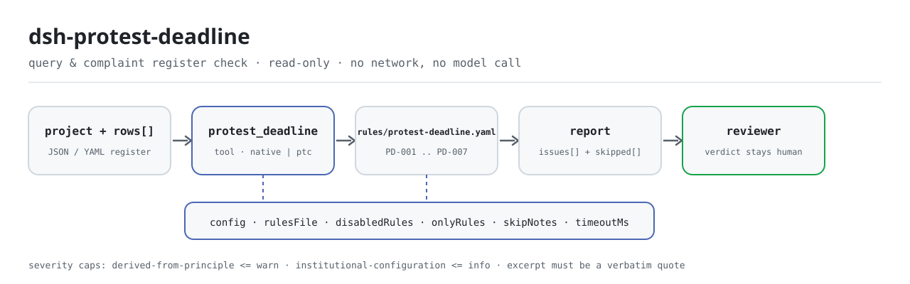

<div align="center">

<picture>
  <source media="(prefers-color-scheme: dark)" srcset="docs/assets/dsh-protest-deadline-flow-dark.svg">
  
</picture>

# dsh-protest-deadline

**Transforme as falhas e as datas fora de ordem de um registo de impugnações e denúncias numa lista, linha a linha, do que falta — o veredicto fica com o revisor.**

Extensão de verificação só de dados para o DeepSeek Harness: lê um registo de impugnações e denúncias (o cabeçalho do projeto mais uma linha por impugnação), aplica o pacote de regras versionado que traz (PD-001..PD-007) e lista apenas as diferenças que consegue apontar dentro do registo — nunca um veredicto de conformidade, nunca uma atribuição de responsabilidade.

[Instalar](#instalação-em-três-passos) · [Configuração](#configuração) · [FAQ](#faq) · [简体中文](README.md) · [English](README.en.md) · [Español](README.es.md) · [Português](README.pt.md) · [हिन्दी](README.hi.md)

[](LICENSE)
[](#compatibilidade)
[](https://www.npmjs.com/package/dsh-protest-deadline)
[](https://github.com/PerryLink/dsh-protest-deadline/actions/workflows/ci.yml)
[](#compatibilidade)

[](https://github.com/PerryLink/dsh-protest-deadline/stargazers)
[](https://www.npmjs.com/package/dsh-protest-deadline)
[](https://dshfind.com/plugins/PerryLink/dsh-protest-deadline?ref=badge)
[](https://securityscorecards.dev/viewer/?uri=github.com/PerryLink/dsh-protest-deadline)
[](https://dsh.market/)
[](https://gitee.com/perrylink/dsh-protest-deadline)

```sh
dsh plugin --profile <name> add dsh-protest-deadline
```

</div>

<sub>Extensão da comunidade, sem relação com a DeepSeek. Repositório canónico: <https://github.com/PerryLink/dsh-protest-deadline> (o Gitee é um espelho).</sub>

## O que é

O `dsh-protest-deadline` lê um registo de impugnações e denúncias — o cabeçalho do projeto mais uma linha por impugnação — e verifica o que esse registo pode sustentar mecanicamente: se em cada linha está registada a data de apresentação ou a de resposta, se ambas as datas são analisáveis e seguem uma ordem, se a resposta cai dentro do prazo que o próprio registo declara, se a data da denúncia não é anterior à da resposta, se cada estado vem do seu próprio vocabulário, se o cabeçalho nomeia o projeto de contratação e se os números de impugnação não se repetem.

Não decide se a impugnação foi apresentada dentro do prazo legal, se deve ser aceite ou se deve ser rejeitada — a lista de diferenças vai para o revisor.

- **Para quem é**: agências de contratação, responsáveis de compras públicas e revisores de controlo interno; não exige linha de comandos — entregue o material no chat.
- **O que entrega**: o material original sobre o qual a verificação trabalha (uma tabela, um registo ou um documento); o original nunca é modificado. O Excel pode ser convertido antes para JSON/YAML, no chat se a plataforma o permitir.
- **O que recebe**: uma lista de «que linha, que coluna, o que falta e como corrigir»; toda a verificação que não pôde ser executada aparece em `skipped` com o motivo.

## Instalação em três passos

1. **Instalar** (escolha um canal):

   ```sh
   # canal git (main mais recente; equivale a git+https://github.com/PerryLink/dsh-protest-deadline.git)
   dsh plugin --profile <name> add github:PerryLink/dsh-protest-deadline
   # canal npm (versões publicadas)
   dsh plugin --profile <name> add dsh-protest-deadline
   # canal tarball: após pnpm pack neste repositório
   dsh plugin --profile <name> add ./dsh-protest-deadline-<version>.tgz
   ```

2. **Configuração mínima** (os valores predefinidos já servem; uma linha de bundle sem `config` usa todos os valores predefinidos e o caminho do pacote de regras aponta para o `rules/protest-deadline.yaml` incluído):

   ```yaml
   - insert:
       - id: dsh-protest-deadline
         name: dsh-protest-deadline
   ```

3. **Verificar que foi montado**:

   ```sh
   dsh --profile <name> --dump-config | grep 'dsh-protest-deadline'
   ```

   Depois entregue-lhe um registo; por exemplo, a amostra incluída (saída esperada em `samples/quickstart/expected/result.json`):

   ```text
   > Executa esta verificação com a amostra incluída e diz-me quantos problemas encontrou e de que nível.
   protest_deadline: 1 issue(s) — error 0, warn 1, info 0
   skipped: 1
   ```

   Também pode executar a amostra localmente (compile `lib/` com `pnpm run build`):

   ```sh
   node samples/quickstart/run.mjs --json
   ```

**Desinstalar**: `dsh plugin --profile <name> remove dsh-protest-deadline` (ou retire a linha do patch do perfil).

<details>
<summary>Usar no WorkBuddy / Coze</summary>

Procure «Tender Compliance Suite» no WorkBuddy / Coze (o conjunto completo; esta verificação é uma parte; disponibilidade conforme o catálogo) para invocar a mesma capacidade sem linha de comandos.

</details>

## Capacidades principais

O `dsh-protest-deadline` registra a ferramenta `protest_deadline`: lê um registo, aplica um pacote de regras versionado e devolve um relatório.

- **Sete regras num pacote de dados** — o pacote de regras é dados, não código (`rules/protest-deadline.yaml`); substituí-lo troca todo o conjunto de verificações sem tocar numa linha de TypeScript.
- **Só leitura sobre o material** — aceita JSON ou YAML e nunca modifica o original; ESM puro, sem pedidos de rede nem chamadas ao modelo.
- **Sem citações inventadas** — cada regra traz `document` / `number` / `clause` / `excerpt` / `kind` / `source`; `excerpt` tem de ser uma citação literal, e as regras ainda não rastreáveis vão para `rules/citations-baseline.json`, uma lista que só pode encolher.
- **A severidade segue a evidência** — `derived-from-principle` tem teto `warn`, a configuração institucional (`institutional-configuration`) teto `info`, e um teste verifica-o.
- **Uma lista de problemas vazia nunca é «não há nada errado»** — toda a verificação que não pôde ser executada é reportada em `skipped` com o motivo; uma regra cuja lista obrigatória não está configurada reporta-se a si mesma em `skipped` em vez de passar em silêncio.
- **Sem linguagem que sentencie** — o relatório enumera diferenças e nunca se pronuncia sobre conformidade, responsabilidade ou correção; um guarda de redação impõe-no e todo o relatório traz o aviso legal.

| Regra | Verificação | Severidade | Tipo de base |
|---|---|---|---|
| `PD-001` | em cada linha consta a data de apresentação ou a de resposta | warn | direct |
| `PD-002` | a data de resposta não é anterior à de apresentação | warn | direct |
| `PD-003` | a resposta cai dentro do prazo registado | info | local |
| `PD-004` | a data da denúncia não é anterior à da resposta | warn | direct |
| `PD-005` | o estado vem do seu vocabulário (desativada por predefinição) | info | local |
| `PD-006` | o cabeçalho nomeia o projeto de contratação (data de apresentação opcional) | warn | principle |
| `PD-007` | os números de impugnação são únicos no registo | warn | principle |

### Exemplos

Estes são os pontos de entrada reais da extensão; instale uma vez e chame um. A primeira linha é o caso detalhado e as restantes são casos breves.

**Exemplo detalhado** — ferramenta `protest_deadline`, entrada:

```json
{"project":"某某设备采购项目","projectNo":"ZC-2026-018","rows":[{"序号":"ZY-2026-001","质疑人":"某某科技有限公司","质疑提出日期":"","答复收到日期":"2026-03-07","答复期限":"2026-03-09","实际答复日期":""}]}
```

Saída:

```json
{
  "id": "dsh-protest-deadline.PD-001.de09b5a6",
  "ruleId": "PD-001",
  "severity": "warn",
  "locator": {
    "row": 1,
    "field": "raisedAt"
  },
  "found": "第 1 行 raisedAt、replyAt 都为空",
  "expected": "raisedAt、replyAt 至少应填写一项",
  "fix": "补填质疑提出日期与答复日期；本条只核对是否填写，不判断是否在法定期限内"
}
```

*Observado em `dsh-protest-deadline/tests/fixtures/PD-001/PD-001-unsafe.json (cases.json expects 1×PD-001); executed parseMaterial+runCheck, checkedAt=2026-10-06T00:00:00.000Z`*

| Você pergunta | O que ele responde |
|---|---|
| Uma linha deixa em branco tanto a data de apresentação como a da resposta. Isso é reportado? | Sim. `PD-001` exige que em cada linha esteja preenchido pelo menos um de `raisedAt` e `replyAt`, e reporta a linha em que ambos estão vazios. Verifica apenas que um dos dois está preenchido, não se a impugnação foi apresentada dentro do prazo legal: isso exige a data em que o fornecedor teve conhecimento, a data da notificação e uma contagem em dias úteis que o registo normalmente não traz. |
| A data da resposta está escrita antes da data de apresentação. Isso é detetado? | `PD-002` compara linha a linha a data de apresentação com a da resposta e reporta `raisedAt` quando é posterior a `replyAt`; o mesmo dia não conta como posterior. Um valor que não consegue analisar — uma data escrita por palavras em vez de `2026-03-15`, `2026/3/15` ou `2026-03-15 09:30` — é reportado nessa linha em vez de ser deixado passar em silêncio. A regra apenas ordena as duas datas que o registo contém. |
| A nossa resposta saiu depois do prazo registado no registo. Foi tardia? | `PD-003` não fixa qualquer número de dias e não pode dizer «tardia»: compara a data real da resposta com o prazo escrito na própria coluna `replyDueAt` do registo, pelo que um achado significa «isto não concorda com o prazo que registou». Com essa coluna vazia não há termo de comparação e a regra aparece em `skipped`, em vez de presumir um prazo. |
| A coluna de estado diz «respondida» e nada foi reportado sobre ela. Porquê? | `PD-005` confronta o estado com o vocabulário que configurar, e `values` vem vazio, pelo que tal como é entregue a regra aparece em `skipped` — a escolha dos valores cabe à sua instituição, não ao motor — em vez de passar em silêncio. Preencha `values` com a sua própria lista (pendente, respondida, denunciada, retirada, …) e qualquer valor fora dela será reportado linha a linha. Verifica apenas se o valor consta da lista, nunca como a impugnação deve ser tratada. |
| O cabeçalho nomeia o projeto mas não traz a data de apresentação ao nível do cabeçalho. Falta algo? | Não. `PD-006` verifica no cabeçalho apenas o projeto de contratação (`project`), porque a data de apresentação é normalmente uma coluna por linha. Se o seu formulário a declara no cabeçalho, a própria nota da regra indica pôr `fields` em `[project, raisedAt]`. A falta do projeto é reportada contra o cabeçalho, não contra uma linha. |
| O mesmo número de impugnação aparece em duas linhas. | `PD-007` reporta a segunda linha e nomeia a primeira, comparando os números sem considerar espaços. Uma repetição costuma significar que a mesma impugnação foi registada duas vezes ou que um número foi copiado mal: distingui-lo é uma decisão humana. Se o registo não tiver coluna de número, a regra reporta que não se aplica em vez de passar. |

## Normas que segue

| Documento | Número | Regras que o citam |
|---|---|---|
| Medidas para a tramitação de impugnações e denúncias na contratação pública (o título chinês canónico consta em `rules/evidence/`) | Ordem do Ministério das Finanças n.º 94 (promulgada a 26 de dezembro de 2017, em vigor desde 1 de março de 2018; seis capítulos e quarenta e cinco artigos; o artigo 45 revoga a Ordem n.º 20, que por isso este pacote nunca cita) | PD-001, PD-002, PD-003, PD-004, PD-005, PD-006, PD-007 |

**Limite:** esta extensão verifica um **registo de impugnações e denúncias** no que um registo pode sustentar mecanicamente: que as datas-chave estão registadas, que são analisáveis e seguem uma ordem, que uma resposta cai dentro do prazo que o próprio registo declara, que os estados vêm do seu vocabulário e que os números de impugnação são únicos. **Não** decide se uma impugnação foi apresentada em prazo, se deve ser aceite ou se deve ser rejeitada. **Essas decisões exigem o comprador ou o departamento de finanças, as datas de notificação e uma base de dias úteis que o livro normalmente não registra.**

> ### ⚠️ Leia isto antes de confiar numa citação do relatório
>
> **O texto da Ordem n.º 94 foi obtido e lido literalmente** — os seis capítulos e quarenta e cinco artigos — e `rules/evidence/clause-verification.md` registra o que foi citado: artigo 10 (impugnação em **7 dias úteis**), artigo 13 (resposta em **7 dias úteis**), artigo 17 (denúncia em 15 dias úteis **após o termo do prazo de resposta**), artigo 21 (5 e 8 dias úteis), artigo 26 (30 dias úteis) e **artigo 42**, que fixa duas regras de cálculo — o dia inicial não conta e o prazo transita quando o último dia é feriado. O artigo 45 ainda **revogou** a Ordem n.º 20, pelo que este pacote nunca a cita. O texto integral da Lei de Contratação Pública, norma superior, também foi lido literalmente (`rules/evidence/clause-verification-law.md`), e os seus prazos coincidem exatamente com os da Ordem.
>
> **O `excerpt` de cada regra é agora uma citação literal.** Uma versão anterior dizia «não obtido» dentro de `excerpt`; em 2026-10-07 as citações foram preenchidas e `check:citations` mantém essa disciplina. A severidade de cada regra continua a ser `warn` ou `info`. O que esta extensão verifica são as datas e colunas de um registo interno; a Ordem regula como os compradores e os departamentos de finanças devem agir. Chamar «infração `direct`» de «responder em 7 dias úteis» a uma coluna vazia seria disfarçar uma falha de registo de incumprimento normativo.
>
> **Esta extensão não fixa qualquer número de dias, e o próprio texto explica por quê.** Os prazos correm em **dias úteis**, o artigo 42 exclui o dia inicial da contagem e transita o prazo quando o último dia é feriado, e o artigo 17 conta a denúncia desde o **termo do prazo de resposta**, não desde a data da resposta — enquanto um registo costuma anotar apenas datas naturais. Por isso `PD-003` compara a data real da resposta com o prazo **escrito na própria coluna `replyDueAt` do registo**, e com essa coluna vazia reporta-se a si mesma em `skipped`. O seu achado diz «isto não concorda com o prazo que registou», **não** «a resposta é tardia».

## Configuração

Todos os parâmetros ajustáveis são campos Schemastery `Config` em `src/config.ts` (alteráveis a partir do cordis.yml); os limites por regra estão no pacote de regras em `rules/`. Uma substituição dirigida por id substitui a linha inteira — repita todas as chaves de que precisa.

| Chave | Tipo | Predefinição | Descrição |
|---|---|---|---|
| `rulesFile` | string | `rules/protest-deadline.yaml` | Caminho do pacote de regras, relativo à raiz do pacote |
| `disabledRules` | string[] | `[]` | Ids de regras a desativar; cada uma aparece em `skipped` |
| `onlyRules` | string[] | `[]` | Executar apenas estas regras; vazio executa todas |
| `skipNotes` | string | `""` | Nota acrescentada a cada motivo de `skipped` |
| `timeoutMs` | number | `120000` | Orçamento de tempo limite cooperativo da ferramenta |

Parâmetros por regra que vale a pena conhecer:

- `PD-003` lê a coluna `replyDueAt` do registo. Calcule esse prazo segundo a Ordem n.º 94 (dias úteis, dia inicial e transição) e escreva-o no livro; a extensão não o deduz.
- `PD-005` `values` — o seu vocabulário de estados, p. ex. `[pendente, respondida, denunciada, encerrada, retirada]`.
- `PD-002` e `PD-004` comparam pares de datas; para verificar também a direção resposta→denúncia, acrescente uma segunda regra com `field: replyAt` e `notAfterField: complaintAt`.

Exemplo de substituição no patch do perfil:

```yaml
- insert:
    - id: dsh-protest-deadline
      name: dsh-protest-deadline
      config:
        disabledRules: [PD-005]
        timeoutMs: 180000
```

## Formato do material

A ferramenta aceita JSON ou YAML:

```yaml
project: 某某设备采购项目
projectNo: ZC-2026-018
agency: 某某采购代理机构
rows:
  - { 序号: ZY-2026-001, 质疑人: 某某科技有限公司, 质疑提出日期: 2026-03-02,
      答复期限: 2026-03-09, 实际答复日期: 2026-03-06, 投诉日期: 2026-03-12, 处理状态: 已答复 }
```

Os nomes de coluna são comparados sem distinguir maiúsculas e sem considerar espaços, underscores nem hífenes; os nomes de coluna do registo são preservados, pelo que um achado nomeia a coluna que leu. As datas podem ser escritas `2026-03-02` ou `2026-03-02 09:30`. Os campos são opcionais na camada de leitura e validados pelo motor de verificação, pelo que uma exportação parcial produz achados de «elemento em falta» em vez de falhar.

## Origem das regras

Os dados das regras vivem em `rules/protest-deadline.yaml`, separados do código: cada regra traz documento, número, cláusula na numeração própria da fonte, trecho literal e URL de origem. O guarda de carregamento impõe que o trecho seja uma citação real de pelo menos oito caracteres; uma verificação cuja base seja apenas um princípio (`kind: derived-from-principle`, teto `warn`) ou uma configuração institucional (`kind: institutional-configuration`, teto `info`) nunca pode ser marcada `error`. Um pacote que exagera a sua base falha ao carregar em vez de produzir um relatório com aparência de solidez.

Os limites confirmados durante a verificação e as conclusões deliberadamente **não** afirmadas estão em `rules/evidence/` (um relatório para a Ordem e outro para a lei superior).

## FAQ

<details>
<summary>Decide a conformidade por nós?</summary>

Não. Apenas enumera as diferenças que consegue apontar dentro do material (que linha, que coluna, o que falta e como corrigir) e não decide factos nem conformidade: a conclusão fica sempre com o revisor. Um guarda de redação impõe a redação do relatório e todo o relatório traz o aviso legal.

</details>

<details>
<summary>O meu registo é um ficheiro Excel. Posso usá-lo diretamente?</summary>

Sim: converta primeiro para JSON ou YAML; a plataforma pode fazer a conversão no chat se o permitir. A ferramenta só lê o material e nunca modifica o original.

</details>

<details>
<summary>Porque é que `PD-005` nunca reporta nada?</summary>

Porque o pacote não inclui vocabulário de estados: `values` está vazio por predefinição e a regra reporta-se a si mesma em `skipped`. Preencha `values` com as formas de estado da sua instituição e a regra começa a verificar que o estado registado consta da lista; mesmo assim não julga como a impugnação deve ser tratada.

</details>

<details>
<summary>Uma lista `issues` vazia pode ser lida como «não há nada errado»?</summary>

Não. Toda a verificação que não pôde ser executada aparece em `skipped` com o motivo (um vocabulário de estados vazio, uma coluna em falta, um prazo de resposta em branco). Leia `issues` e `skipped` em conjunto antes de tirar qualquer conclusão do relatório.

</details>

<details>
<summary>Porque é que `PD-003` diz «não concorda» e não «tardia»?</summary>

Porque apenas compara a data real da resposta com o prazo que o próprio registo declara em `replyDueAt`. O prazo legal corre em dias úteis com as suas próprias regras de dia inicial e transição, enquanto um registo costuma anotar datas naturais; a extensão não converte dias naturais em úteis nem assume um prazo por você. Um achado significa «isto não concorda com o prazo que registou».

</details>

<details>
<summary>O material é enviado para a internet ou usado para treino?</summary>

Não. A extensão não usa a rede, não chama um modelo, só lê o material e nunca escreve no original; o relatório é produzido localmente.

</details>

## Limites de segurança

- **Só leitura sobre o material.** A ferramenta lê o ficheiro ou o texto em linha que lhe entrega e nunca modifica o original; não há caminho de escrita nem segunda cópia.
- **Sem rede nem chamadas ao modelo.** A verificação é comparação local de colunas e datas; o `dsh.demo` do `package.json` também marca `network` como `false` e `writes` como vazio.
- **Sem linguagem que sentencie.** O relatório nunca se pronuncia sobre conformidade, responsabilidade ou correção; o guarda de redação impõe-no e todo o relatório traz o aviso.
- **Sem citações inventadas.** Um `excerpt` tem de ser uma citação literal localizável em `rules/evidence/`; as regras não rastreáveis vão para `citations-baseline.json`, uma lista que só pode encolher.
- **Falha de forma fechada.** Severidades fora do intervalo, listas obrigatórias ausentes e pacotes de regras que não carregam lançam um erro explícito ao carregar ou ao executar, em vez de produzir um relatório vazio com aparência plausível.

## Limitações conhecidas

- **Não é fixado qualquer número de dias.** O prazo legal corre em dias úteis e está sujeito às regras de dia inicial e transição do artigo 42, pelo que `PD-003` só compara com o `replyDueAt` do próprio registo; com essa coluna vazia passa a `skipped`.
- **As datas têm de ser numéricas.** `2026-03-02` e `2026-03-02 09:30` são analisadas; uma data escrita por palavras é reportada como não analisável — deliberadamente, para não adivinhar.
- **`PD-005` está inativa de fábrica.** Os valores de estado variam entre instituições, pelo que a extensão não inclui qualquer lista.
- **Apenas campos do registo.** Não verifica datas de notificação, anexos, o processo de revisão nem o mérito de uma impugnação ou denúncia.
- **Apenas JSON ou YAML.** Excel e outros formatos têm de ser convertidos primeiro; a ferramenta não analisa folhas de cálculo binárias.
- **As lacunas de evidência são declaradas.** A cópia da Lei de Contratação Pública lida foi o texto promulgado em 2002; a alteração de 2014 não foi obtida, pelo que nada se afirma sobre a sua «vigência atual».
- **`timeoutMs` é um orçamento cooperativo.** Limita a espera da ferramenta, não é uma interrupção forçada; registos muito grandes devem ser enviados por lotes.

## Interoperabilidade com outros plugins DSH

A extensão ocupa um único nome de ferramenta e não participa em disputas por comandos, eventos ou lugares de interface:

- **Uma única ferramenta.** A ferramenta chama-se `protest_deadline`; não registra comandos, nem slots de cliente, nem prefixos de `webServer`. Se colidir com uma ferramenta sua, remova esta linha para desinstalar.
- **Declara apenas o serviço `tools`.** `inject` contém `tools` e mais nada, pelo que não há conflito de chaves de serviço.
- **Não escuta qualquer evento.** Não há ouvintes de `agent/pre-step` nem de `tools/post-execute`, pelo que não se insere numa cadeia partilhada nem a curto-circuita.
- **O patch só insere a sua própria linha.** A camada do bundle nunca sobrescreve o `config` de uma linha integrada e nunca altera globais nem `process.env`.

## Compatibilidade

| Superfície | Estado |
|---|---|
| Harness | Intervalo de peers `>=0.1.2-rc.1 <0.2.0 \|\| >=0.2.0-0 <0.3.0` — verificado para aceitar tanto `0.2.0-rc.2` como `0.2.1-rc.2`. `engines.dsh` é declarado como `>=0.2.1-0 <0.3.0` e o host aplica-o desde 0.2.1 |
| Node | `^22.19.0 \|\| >=24.0.0` |
| Plataformas | Todas (ESM puro; sem código nativo, sem rede, sem chamada ao modelo) |
| Modo de ferramenta | Funciona em `native` e `ptc`; para um diretório inteiro use `ptc`, onde o custo do esquema é pago uma vez |

## Resolução de problemas

- **`PD-003` reporta-se como omitida.** O registo não anota prazo de resposta. É deliberado: o prazo legal conta-se em dias úteis e a extensão não converte datas naturais nele.
- **`PD-003` dispara mas considero a resposta pontual.** O `replyDueAt` do registo não concorda com a data real da resposta: ou a coluna do prazo foi calculada mal, ou a data da resposta está mal.
- **`PD-005` nunca é executada.** O seu vocabulário de estados está vazio; preencha-o com os valores de estado do seu registo.
- **`PD-002` dispara com datas que eu consigo ler.** O leitor aceita `2026-03-02` e `2026-03-02 09:30`; uma data escrita por palavras é reportada como não analisável de propósito.
- **A extensão instala mas a ferramenta não aparece.** Verifique que `main` resolve para `lib/index.mjs` e que `pnpm run build` o gerou; um `main` errado faz o carregador saltar a entrada em silêncio.
- **`dsh plugin add` recusa o pacote como incompatível.** O intervalo de peers cobre `0.1.x` e `0.2.x`; se o seu runtime estiver fora, conceda uma isenção explícita: `dsh plugin --profile <name> allow-version dsh-protest-deadline@0.1.0 --dsh-version <runtime> --accept-risk`
- **`check` reporta `manifest-peers` como falha.** O verificador estático compara com um intervalo de peers fixo anterior à linha 0.2. O runtime aplica a compatibilidade de peers na instalação, pelo que o intervalo declarado é o correto; é um problema conhecido do `dsh-plugin-dev`.
- **Os horários parecem deslocados.** Toda a aritmética é de hora local sobre as cadeias de entrada, sem conversão de fuso horário.

## Ecossistema e qualidade

- [Espelho no Gitee](https://gitee.com/perrylink/dsh-protest-deadline) (espelho sincronizado; o GitHub é o canónico)
- [Página no dshfind](https://dshfind.com/plugins/PerryLink/dsh-protest-deadline) (instalações e classificação)
- [Relatório OpenSSF Scorecard](https://securityscorecards.dev/viewer/?uri=github.com/PerryLink/dsh-protest-deadline) (impulsionado por [.github/workflows/scorecard.yml](.github/workflows/scorecard.yml))
- [DSH Market](https://dsh.market/) (publicado)
- **Canal da loja 1024**: `npm i -g dsh1024` uma vez e depois `dsh1024 plugin --profile <name> add dsh-protest-deadline` (conta para a classificação de instalações de [deepseek1024.com](https://deepseek1024.com))
- [Base de conhecimento do ecossistema](https://perrylink.github.io/dsh-plugin-guide/) — guia de desenvolvimento de plugins · dados de seleção · critérios de manutenção

## Desenvolvimento

```sh
pnpm install                                        # node ^22.19 || >=24
pnpm run typecheck                                  # tsc --noEmit
pnpm test                                           # vitest: suite partilhada de plugins de tabela + fixtures emparelhados
pnpm run build                                      # tsdown -> lib/index.mjs + lib/index.d.mts
pnpm run verify:self-contained                      # as dependências resolvem-se a partir do registo
pnpm run check:lockfile                             # verificação de deriva do lockfile
pnpm run check:readmes                              # consistência dos README em cinco idiomas
pnpm run check:citations                            # linha de base de citações do pacote de regras
node ../scripts/sync-shared.mjs dsh-protest-deadline  # atualizar src/shared a partir de ../_shared
pnpm pack                                           # o tarball publicado
```

A extensão é **só de dados**: `src/model.ts` declara a forma da tabela, o kit partilhado fornece o leitor e o motor de verificação, e o pacote de regras declara cada verificação. Execução local da amostra (compile primeiro `lib/`):

```sh
node samples/quickstart/run.mjs --json
# => {"tool":"protest_deadline","issueCount":1,"summary":{"error":0,"warn":1,"info":0},"skippedCount":1}
```

A entrada da amostra está em `samples/quickstart/input/`, a saída esperada em `samples/quickstart/expected/result.json` e uma captura em `docs/assets/quickstart.png`. As imagens dos README são geradas programaticamente por [`scripts/gen-readme-assets.py`](scripts/gen-readme-assets.py) (Python + Pillow) e o script pode ser executado novamente; o antigo diagrama de fluxo de uma só variante e as imagens de demonstração permanecem em `docs/assets/` para ligações externas, enquanto os README apenas referenciam o novo par claro/escuro.

Topics: `deepseek-harness`, `dsh`, `dsh-plugin`, `cordis`, `protest`, `deadline`

## Família e agradecimentos

Este projeto faz parte da família de plugins do DeepSeek Harness mantida pela [PerryLink](https://github.com/PerryLink) (todos Apache-2.0). Índice completo da família: [escolher um verificador por material](https://perrylink.github.io/zh/checkers/choose/). Se for útil, **uma estrela ajuda a próxima pessoa a encontrá-lo** — não desbloqueia nada.

- [@PerryLink](https://github.com/PerryLink) — criador e mantenedor: o pacote de regras só de dados (PD-001..PD-007), a ferramenta `protest_deadline`, o registo de verificação de citações e a documentação em cinco idiomas.

<details>
<summary>Expandir todos os plugins</summary>

| Plugin | Estado |
|---|---|
| **[dsh-aqua-input-check](https://github.com/PerryLink/dsh-aqua-input-check)** |  |
| **[dsh-archive-check](https://github.com/PerryLink/dsh-archive-check)** |  |
| **[dsh-auto-review](https://github.com/PerryLink/dsh-auto-review)** |  |
| **[dsh-autotier](https://github.com/PerryLink/dsh-autotier)** | 🧊 CONGELADO — ver o README do repo |
| **[dsh-bid-ca-precheck](https://github.com/PerryLink/dsh-bid-ca-precheck)** |  |
| **[dsh-bid-qual-check](https://github.com/PerryLink/dsh-bid-qual-check)** |  |
| **[dsh-cert-mcp](https://github.com/PerryLink/dsh-cert-mcp)** | 🧊 CONGELADO — ver o README do repo |
| **[dsh-checkpoint-rewind](https://github.com/PerryLink/dsh-checkpoint-rewind)** |  |
| **[dsh-click](https://github.com/PerryLink/dsh-click)** |  |
| **[dsh-composer-history](https://github.com/PerryLink/dsh-composer-history)** |  |
| **[dsh-contract-stance](https://github.com/PerryLink/dsh-contract-stance)** |  |
| **[dsh-customs-doc-check](https://github.com/PerryLink/dsh-customs-doc-check)** |  |
| **[dsh-data-quality](https://github.com/PerryLink/dsh-data-quality)** | 🧊 CONGELADO — ver o README do repo |
| **[dsh-demurrage-ledger](https://github.com/PerryLink/dsh-demurrage-ledger)** |  |
| **[dsh-doublecheck](https://github.com/PerryLink/dsh-doublecheck)** |  |
| **[dsh-drill-script-check](https://github.com/PerryLink/dsh-drill-script-check)** |  |
| **[dsh-eia-guide-check](https://github.com/PerryLink/dsh-eia-guide-check)** |  |
| **[dsh-emergency-plan](https://github.com/PerryLink/dsh-emergency-plan)** |  |
| **[dsh-essay-rubric-check](https://github.com/PerryLink/dsh-essay-rubric-check)** |  |
| **[dsh-evidence-check](https://github.com/PerryLink/dsh-evidence-check)** |  |
| **[dsh-export-ctl-check](https://github.com/PerryLink/dsh-export-ctl-check)** |  |
| **[dsh-fast](https://github.com/PerryLink/dsh-fast)** |  |
| **[dsh-fmea-table-check](https://github.com/PerryLink/dsh-fmea-table-check)** |  |
| **[dsh-forecast-penalty](https://github.com/PerryLink/dsh-forecast-penalty)** |  |
| **[dsh-fund-research](https://github.com/PerryLink/dsh-fund-research)** |  |
| **[dsh-github](https://github.com/PerryLink/dsh-github)** |  |
| **[dsh-gongwen-flow-check](https://github.com/PerryLink/dsh-gongwen-flow-check)** |  |
| **[dsh-gongwen-word-check](https://github.com/PerryLink/dsh-gongwen-word-check)** |  |
| **[dsh-guard-plan-qc](https://github.com/PerryLink/dsh-guard-plan-qc)** |  |
| **[dsh-hazchem-check](https://github.com/PerryLink/dsh-hazchem-check)** |  |
| **[dsh-hazplan-check](https://github.com/PerryLink/dsh-hazplan-check)** |  |
| **[dsh-hidden-risk-map](https://github.com/PerryLink/dsh-hidden-risk-map)** |  |
| **[dsh-hs-classify](https://github.com/PerryLink/dsh-hs-classify)** |  |
| **[dsh-icd-rule-check](https://github.com/PerryLink/dsh-icd-rule-check)** |  |
| **[dsh-industry-research](https://github.com/PerryLink/dsh-industry-research)** |  |
| **[dsh-lawcite-adapter](https://github.com/PerryLink/dsh-lawcite-adapter)** |  |
| **[dsh-laya](https://github.com/PerryLink/dsh-laya)** |  |
| **[dsh-lc-doc-check](https://github.com/PerryLink/dsh-lc-doc-check)** |  |
| **[dsh-learning-gap-check](https://github.com/PerryLink/dsh-learning-gap-check)** |  |
| **[dsh-library](https://github.com/PerryLink/dsh-library)** |  |
| **[dsh-local-ai](https://github.com/PerryLink/dsh-local-ai)** |  |
| **[dsh-lsp-actions](https://github.com/PerryLink/dsh-lsp-actions)** |  |
| **[dsh-mask](https://github.com/PerryLink/dsh-mask)** |  |
| **[dsh-mcp-panel](https://github.com/PerryLink/dsh-mcp-panel)** |  |
| **[dsh-medrec-qc](https://github.com/PerryLink/dsh-medrec-qc)** |  |
| **[dsh-memento](https://github.com/PerryLink/dsh-memento)** | 🧊 CONGELADO — ver o README do repo |
| **[dsh-nsfc-form-check](https://github.com/PerryLink/dsh-nsfc-form-check)** |  |
| **[dsh-nurse-record-check](https://github.com/PerryLink/dsh-nurse-record-check)** |  |
| **[dsh-observe](https://github.com/PerryLink/dsh-observe)** |  |
| **[dsh-origin-rvc-check](https://github.com/PerryLink/dsh-origin-rvc-check)** |  |
| **[dsh-ota-review-check](https://github.com/PerryLink/dsh-ota-review-check)** |  |
| **[dsh-output-styles](https://github.com/PerryLink/dsh-output-styles)** |  |
| **[dsh-paper-doc-adapter](https://github.com/PerryLink/dsh-paper-doc-adapter)** |  |
| **[dsh-permission-rules](https://github.com/PerryLink/dsh-permission-rules)** |  |
| **[dsh-permit-report-check](https://github.com/PerryLink/dsh-permit-report-check)** |  |
| **[dsh-pipeline-check](https://github.com/PerryLink/dsh-pipeline-check)** |  |
| **[dsh-pleading-draft](https://github.com/PerryLink/dsh-pleading-draft)** |  |
| **[dsh-plugin-doctor](https://github.com/PerryLink/dsh-plugin-doctor)** | 🚫 APOSENTADO (repo arquivado) |
| **[dsh-plugin-guide](https://github.com/PerryLink/dsh-plugin-guide)** |  |
| **[dsh-plugin-kit](https://github.com/PerryLink/dsh-plugin-kit)** | 🚫 APOSENTADO (repo arquivado) |
| **[dsh-plugin-upgrade](https://github.com/PerryLink/dsh-plugin-upgrade)** | 🚫 APOSENTADO (repo arquivado) |
| **[dsh-policy-brief-draft](https://github.com/PerryLink/dsh-policy-brief-draft)** |  |
| **[dsh-power-loss-split](https://github.com/PerryLink/dsh-power-loss-split)** |  |
| **[dsh-power-ticket-check](https://github.com/PerryLink/dsh-power-ticket-check)** |  |
| **[dsh-ppap-check](https://github.com/PerryLink/dsh-ppap-check)** |  |
| **[dsh-protest-deadline](https://github.com/PerryLink/dsh-protest-deadline)** |  |
| **[dsh-railway-window](https://github.com/PerryLink/dsh-railway-window)** |  |
| **[dsh-repair-order-qc](https://github.com/PerryLink/dsh-repair-order-qc)** |  |
| **[dsh-research-report](https://github.com/PerryLink/dsh-research-report)** |  |
| **[dsh-review-reply-check](https://github.com/PerryLink/dsh-review-reply-check)** |  |
| **[dsh-rulefile-check](https://github.com/PerryLink/dsh-rulefile-check)** |  |
| **[dsh-safety-brief-check](https://github.com/PerryLink/dsh-safety-brief-check)** |  |
| **[dsh-score](https://github.com/PerryLink/dsh-score)** | 🧊 CONGELADO — ver o README do repo |
| **[dsh-session-sync](https://github.com/PerryLink/dsh-session-sync)** |  |
| **[dsh-site-log-check](https://github.com/PerryLink/dsh-site-log-check)** |  |
| **[dsh-skill-pack-security](https://github.com/PerryLink/dsh-skill-pack-security)** |  |
| **[dsh-soe-decision-check](https://github.com/PerryLink/dsh-soe-decision-check)** |  |
| **[dsh-soilwater-check](https://github.com/PerryLink/dsh-soilwater-check)** |  |
| **[dsh-sop-sync-check](https://github.com/PerryLink/dsh-sop-sync-check)** |  |
| **[dsh-spc-gbt-adapter](https://github.com/PerryLink/dsh-spc-gbt-adapter)** |  |
| **[dsh-talk](https://github.com/PerryLink/dsh-talk)** |  |
| **[dsh-tender-extract](https://github.com/PerryLink/dsh-tender-extract)** |  |
| **[dsh-tender-matrix](https://github.com/PerryLink/dsh-tender-matrix)** |  |
| **[dsh-test-drive](https://github.com/PerryLink/dsh-test-drive)** |  |
| **[dsh-ticktick](https://github.com/PerryLink/dsh-ticktick)** | 🚫 APOSENTADO (repo arquivado) |
| **[dsh-translate](https://github.com/PerryLink/dsh-translate)** |  |
| **[dsh-warranty-calc](https://github.com/PerryLink/dsh-warranty-calc)** |  |
| **[dsh-budget](https://github.com/PerryLink/dsh-budget)** | 🧊 CONGELADO — ver o README do repo |
| **[dsh-claude-move](https://github.com/PerryLink/dsh-claude-move)** | 🧊 CONGELADO — ver o README do repo |
| **[dsh-defend](https://github.com/PerryLink/dsh-defend)** | 🧊 CONGELADO — ver o README do repo |
| **[dsh-draw](https://github.com/PerryLink/dsh-draw)** | 🧊 CONGELADO — ver o README do repo |
| **[dsh-reach](https://github.com/PerryLink/dsh-reach)** | 🧊 CONGELADO — ver o README do repo |
| **[dsh-background-agents](https://github.com/PerryLink/dsh-background-agents)** | 🚫 APOSENTADO (repo arquivado) |
| **[dsh-session-pin](https://github.com/PerryLink/dsh-session-pin)** | 🚫 APOSENTADO (repo arquivado) |
| **[dsh-team-rooms](https://github.com/PerryLink/dsh-team-rooms)** | 🚫 APOSENTADO (repo arquivado) |

</details>

## Licença

[LICENSE](LICENSE) (Apache License 2.0) © 2026 dsh-protest-deadline contributors

<p align="center"><sub>Apache-2.0 · Extensão da comunidade, sem relação com a DeepSeek.</sub></p>
